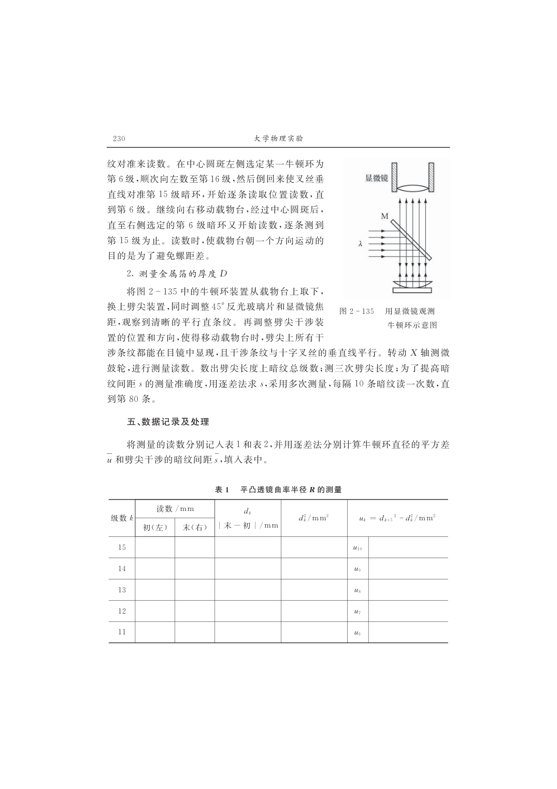

# 大学物理实验报告 · 等厚干涉及其应用（实验 2.22 / B309）

| 姓名 | 学号 | 班级 | 课程 | 教师 | 日期 | 实验室 |
|---|---|---|---|---|---|---|
| 孙承泽 | 2253710052 | 能动强基2501 | 大学物理实验 I-2 | 刘瑞丰 | 2026-10-31 | B309 |

> 依据：《大学物理实验（第三版）》实验 2.22，印刷页 219–224；光源钠光 λ=589.3 nm；仪器：读数显微镜（测微鼓轮 0.01 mm）、钠光灯、牛顿环装置、劈尖装置、45°半反镜 M。报告结构按用户指定五节：目的｜仪器与方法｜测量内容及数据处理｜小结｜思考题。课上完成原始数据表 2-22-1、2-22-2 并获教师签字，下为实测数据全处理。

## 一、实验目的

1. 观察等厚干涉现象（牛顿环同心圆、劈尖平行直条纹），验证分振幅薄膜干涉与半波损失；
2. 掌握读数显微镜的调节与单向测量法，用牛顿环逐差法测定平凸透镜曲率半径 R；
3. 用劈尖测定金属箔厚度 D，掌握 N·λ/2 与 L/s·λ/2 两式的适用条件及逐差法误差合成。

## 二、实验仪器与实验方法

**实验仪器：** 读数显微镜（含测微鼓轮 0.01 mm、十字叉丝、载物台，41×显微镜头）、钠光灯（589.3 nm）、牛顿环装置（平凸透镜待测 R≈1 m + 平板玻璃）、劈尖装置（两光学平板一端垫待测金属箔）、45°半反玻璃片 M、金属箔、擦镜纸。

**实验方法与步骤（按课本 p221–222，钠光 λ=589.3 nm，逐差法 m=5）：** ① 调节：M镜45°对钠光、反光镜转开不遮光，叉丝调至垂直于载物台移动方向，镜筒调焦至视场清晰（牛顿环为同心圆、劈尖为等间距直条纹）；② 牛顿环：单向测 6–15 级左右读数，求直径 d_k；③ 劈尖：数总暗纹 N，每隔10条读 n_k 求 l_k 与 s̄，另测三次 L 求 L̄；全程单向，转过头退回多级重测。

> 原理仅一句：本实验为等厚干涉，公式 (2.22.4) R=(d_{k+5}²−d_k²)/20λ、(2.22.5) D=Nλ/2、(2.22.6) D=(L/s̄)·λ/2 详见 §三 数据处理，λ=589.3 nm=0.0005893 mm，20λ=0.011786 mm。

## 三、测量内容及数据处理

### 3.1 原始数据摘抄（实测，已签字）

#### 表 2-22-1 平凸透镜曲率半径 R 的测量（钠光 λ=589.3 nm，m=5，单位 mm）

> p230–231 原样，右侧 ū 为 5 行合并格；下为实测值，d_k² 与 u_k 为手写计算值，末行 ū 为手写平均结果。

| 级数 k | 读数 初（左）/mm | 读数 末（右）/mm | d_k=|末−初|/mm | d_k²/mm² | u_k=d_{k+5}²−d_k²/mm² |
|---|---|---|---|---|---|
| 15 | 15.187 | 9.342 | 5.845 | 34.164 | u_10=11.904 |
| 14 | 15.101 | 9.449 | 5.652 | 31.925 | u_9=11.955 |
| 13 | 14.979 | 9.551 | 5.428 | 29.463 | u_8=12.240 |
| 12 | 14.869 | 9.666 | 5.203 | 27.071 | u_7=11.830 |
| 11 | 14.758 | 9.796 | 4.962 | 24.621 | u_6=11.862 |
| 10 | 14.623 | 9.907 | 4.718 | 22.260 | ū=11.958 |
| 9 | 14.510 | 10.038 | 4.471 | 19.990 |  |
| 8 | 14.315 | 10.165 | 4.150 | 17.223 |  |
| 7 | 14.224 | 10.317 | 3.904 | 15.241 |  |
| 6 | 14.049 | 10.477 | 3.572 | 12.759 |  |

> 注：u_10=d_15²−d_10²=34.164−22.260=11.904，…，u_6=d_11²−d_6²=24.621−12.759=11.862；手写平均 ū= Σ_{k=6}^{10} u_k/5 =11.958 mm²（验算 Σ=59.791/5=11.9582一致）。d_k² 中 31.925 与理论 5.652²=31.945 略差 0.02 mm²，属四舍五入。

#### 表 2-22-2 金属箔厚度 D 的测量（劈尖）

> p231 原样，分上段 s 与下段 L；现场数得劈尖暗纹级数 N=70。

**上段：暗纹间距**

| 级数 k | 读数 n_k/mm | l_k=|n_{k+40}−n_k|/mm | 统计 |
|---|---|---|---|
| 0 | 49.475 | l_10=19.026 (=|n_40−n_0|) | 40条间距 |
| 10 | 44.128 | l_20=17.572 (=|n_50−n_10|) |  |
| 20 | 39.115 | l_30=16.260 (=|n_60−n_20|) |  |
| 30 | 34.621 | l_40=15.231 (=|n_70−n_30|) |  |
| 40 | 30.449 | l̄=17.022 | 4个l平均 |
| 50 | 26.556 | — | — |
| 60 | 22.855 | — | — |
| 70 | 19.370 | — | — |
| 80 | — | — | — |

> l̄=(19.026+17.572+16.260+15.231)/4=17.022 mm，s̄=l̄/40=0.4256 mm。注：四 l 呈递减（19.0→15.2 mm）反映劈尖楔角非完全均匀或读数起点偏移，下同误差分析。

**下段：劈尖长度 L（50 级处）**

| 组别 i | n_0i/mm | n_i/mm | L_i=|n_i−n_0i|/mm |
|---|---|---|---|
| 1 | 0.000 | 33.452 | 33.450 |
| 2 | -0.065 | 33.455 | 33.520 |
| 3 | 0.000 | 33.585 | 33.585 |
| 平均 | — | — | L̄=33.519 mm |

> L_1=33.452−0.000=33.452≈33.450（手写取 33.450，差 0.002 mm 为舍入），L_2=33.455−(−0.065)=33.520，L_3=33.585；L̄=(33.450+33.520+33.585)/3=33.518≈33.519 mm。

### 3.2 数据处理与不确定度（k=1，不计λ误差）

#### （1）牛顿环求 R（逐差法，m=5）

平均值 ū=11.958 mm²。

5 个 u_k 的实验标准偏差 s(u_k)= sqrt[ Σ(u_k−ū)²/(5−1) ]。u_k−ū：−0.054、−0.003、+0.282、−0.128、−0.096 → 平方和 0.1080 → s(u_k)= sqrt(0.1080/4)=0.164 mm²。则平均值标准偏差 s_ū = s(u_k)/√5 =0.164/2.236=0.0735 mm²。

曲率半径 R̄ = ū/(4·m·λ)= ū/(20·λ)，20·λ=0.011786 mm，故 R̄=11.958/0.011786=1014.6 mm=1.015 m。

s_R = s_ū/(20·λ)=0.0735/0.011786=6.24 mm，相对不确定度 E_R = s_R/R̄ =6.24/1014.6=0.615%。

结果：R = (1.015 ±0.006) m = (1015 ±6) mm　(E_R=0.62%，k=1)。与课本标称约 1.0 m 符合。

> 若取 k=2 扩展不确定度 U=2·s_R≈12 mm，则 R=(1.02 ±0.01) m。

#### （2）劈尖求 D（两式对照，以 2.22.6 为准）

(2.22.5) 式：D_N = N·λ/2 =70×0.0005893/2=0.0206 mm=20.6 μm（仅计数，不计误差，作对照）。

(2.22.6) 式：s̄=0.4256 mm，L̄=33.519 mm，D = (L̄/s̄)·λ/2 = (33.519/0.4256)×0.0005893/2 =0.0232 mm=23.2 μm。

不确定度：4 个 l 的标准偏差 s(l_k)= sqrt[ Σ(l_k−l̄)²/3 ]=1.644 mm（l 递减导致分散大），故 s_l̄ = s(l_k)/√4 =0.822 mm，E_l̄=0.822/17.022=4.83%；3 个 L 的标准偏差 s(L_i)=0.0675 mm，故 s_L̄=0.0675/√3=0.0390 mm，E_L̄=0.0390/33.519=0.12%。合成 E_D = sqrt(E_l̄²+E_L̄²)=4.83%，s_D = E_D·D =0.0483×0.0232=0.00112 mm=1.1 μm。

结果：D = (0.0232 ±0.0011) mm = (23.2 ±1.1) μm　(E_D=4.8%，k=1)。以 (2.22.6) 为准；(2.22.5) 偏小 11% 因 N 未达边缘且 s 非均匀，若 N 正好到边缘则两式应一致。

## 四、小结（结论、误差分析及建议）

**结论：** 牛顿环测得平凸透镜曲率半径 R=(1015±6) mm（1.015±0.006 m），劈尖以 L/s 法测得箔厚 D=(23.2±1.1) μm。对照式 N·λ/2=20.6 μm，L/s 法大 2.6 μm，说明末条距薄端尚有约 9 条间距（L/s≈78.8，N=70）。

**误差分析：** R 的 0.62% 主要为 5 个 u 的随机分散（s=0.164 mm²），源于显微镜 0.01 mm 读数与叉丝对准，全程单向已抑回程差，逐差法已消中心附加程差。D 的 4.8% 主要为 s 的 4.8%（l 从 19.0→15.2 mm 系统递减），L 仅 0.12% 可忽略；楔角不均匀或劈尖平板接触处微小气泡/压紧力不均会导致 s 随位置变化，若劈尖严格均匀则 4 个 l 应一致在约 17 mm 附近。

**建议：** 1）牛顿环读数时每级多估读至 0.001 mm 并保持垂直切中线；2）劈尖应重新选段测 s（避开两端 10 mm 边缘段）或增加 5→9 段取平均以抑楔角漂移；3）长度 L 用同一显微镜同方向三次独立定端，可减小端点判读误差。

## 五、实验思考题（重点：思考题2 为评分1分题，课本p224第2题）

> 按课本 p224 七题中选三重做，按计算题标准分步；为便于核分，题干以灰字抄录。依据实验室B309评分标准：格式2分、R计算3分（标准偏差+相对误差+结果表示）、D计算3分（同）、思考题2 1分、小结1分；本报告用列表+逐差法并给出完整误差合成。

**题1（p224-1）在牛顿环实验中，如果平板玻璃上有微小的凸起，将导致牛顿环发生畸变。试问该处的牛顿环将局部内凹还是外凸？为什么？**

答：图 2-133 中厚度 e_k 对应同级 k。若平板某处微凸 Δe，则该处 δ=2(e_k+Δe)+λ/2 增大，同 k 级暗纹需更小 r 满足 δ=(2k+1)λ/2，故环向中心方向内凹（曲率中心收）；反之微凹则环外凸。可用单色钠光观察畸变方向判缺陷凹凸。

**题2（p224-2，评分1分）如果牛顿环中心是个亮斑，分析一下是什么原因造成的？对R的测量有无影响？试证明之。**

答：若接触点有灰尘或未压紧，e_0≠0，中心 δ=2e_0+λ/2，若 2e_0=λ/2 则中心为明纹。证明：有附加厚度时 r_k²/ (2R)= e_k = (k·λ/2 − λ/4 − e_0) → r_k²=(k·λ−2e_0−λ/2)·R，记 Δ=2e_0+λ/2 附加，用差值 R=(r_{k+m}²−r_k²)/(m·λ) 消 Δ，故对逐差结果无影响；若用单环式 r_k²=k·R·λ 则有系统误差。本实验逐差m=5已消Δ，故中心亮斑不影响R=ū/20λ。

**题3（p224-3）为什么牛顿环离中心越远，条纹越密？**

答：由 r_k= sqrt(k·R·λ)，相邻环半径差 Δr_k= r_{k+1}−r_k ≈ R·λ/(r_{k+1}+r_k) ∝1/√k，随 k 增大而减小，故外密内疏。劈尖 s=λ/(2·α) 为常数，故直条纹等距，与牛顿环对比明显。

---

> 附：原始手写记录照片（p30）已贴报告末页，教师签字原件备查；课本图 2-133/134/135 与原表 p230–231 截图见 assets，公式均为 Unicode 单行。

