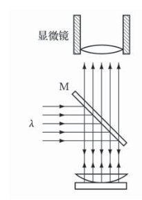

# 大学物理实验报告 · 等厚干涉及其应用（实验 2.22 / B309）

| 姓名 | 学号 | 班级 | 课程 | 教师 | 日期 | 实验室 |
|---|---|---|---|---|---|---|
| 孙承泽 | 2253710052 | 能动强基2501 | 大学物理实验 I-2 | 刘瑞丰 | 2026-10-31 | B309 |

> 依据：《大学物理实验（第三版）》实验 2.22，印刷页 219–224；光源钠光 $\lambda = 589.3\text{ nm}$；仪器：读数显微镜（测微鼓轮分度值 $0.01\text{ mm}$）、钠光灯、牛顿环装置、劈尖装置、$45^\circ$ 半反镜 $\text{M}$。报告结构按五节：目的｜仪器与方法｜测量内容及数据处理｜小结｜思考题。课上完成原始数据表 2-22-1、2-22-2 并获教师签字，下为实测数据全处理（公式采用 KaTeX 排版）。

## 一、实验目的

1. 观察等厚干涉现象（牛顿环同心圆 $e = \dfrac{r^2}{2R}$、劈尖平行直条纹 $e = k\dfrac{\lambda}{2}$），验证分振幅薄膜干涉与半波损失 $\dfrac{\lambda}{2}$；
2. 掌握读数显微镜的调节与单向测量法，用牛顿环逐差法测定平凸透镜曲率半径 $R$；
3. 用劈尖测定金属箔厚度 $D$，掌握 $D = N\dfrac{\lambda}{2}$ 与 $D = \dfrac{L}{s}\cdot\dfrac{\lambda}{2}$ 两式的适用条件及逐差法不确定度合成。

## 二、实验仪器与实验方法

**实验仪器：** 读数显微镜（含测微鼓轮 $0.01\text{ mm}$、十字叉丝、载物台，$41\times$ 显微镜头）、钠光灯（$\lambda = 589.3\text{ nm}$）、牛顿环装置（平凸透镜待测 $R \approx 1\text{ m}$ + 平板玻璃）、劈尖装置（两光学平板一端垫待测金属箔）、$45^\circ$ 半反玻璃片 $\text{M}$、金属箔、擦镜纸。

**实验方法与步骤（按课本 p221–222，钠光 $\lambda = 589.3\text{ nm}$，逐差法 $m = 5$）：** ① 调节：$\text{M}$ 镜 $45^\circ$ 对钠光、反光镜转开不遮光，叉丝调至垂直于载物台移动方向，镜筒调焦至视场清晰（牛顿环为同心圆、劈尖为等间距直条纹）；② 牛顿环：单向测 $6\sim 15$ 级左右读数，求直径 $d_k$；③ 劈尖：数总暗纹级数 $N$，每隔 $10$ 条读 $n_k$ 求 $l_k$ 与 $\bar{s}$，另测三次 $L$ 求 $\bar{L}$；全程单向移动，转过头须退回多级重测。

> 原理仅一句：本实验为等厚干涉，公式 (2.22.4) $R = \dfrac{d_{k+5}^2 - d_k^2}{20\lambda}$、(2.22.5) $D = N\dfrac{\lambda}{2}$、(2.22.6) $D = \dfrac{\bar{L}}{\bar{s}}\cdot\dfrac{\lambda}{2}$ 详见 §三 数据处理，其中 $\lambda = 589.3\text{ nm} = 0.0005893\text{ mm}$，$20\lambda = 0.011786\text{ mm}$。

## 三、测量内容及数据处理

### 3.1 原始读数与派生数据（原始实测读数保留，派生量按读数复算）

> **复核说明：** 保留表中所有原始显微镜读数不变；原稿若干派生数与这些读数相减/平方不一致，本版按原始读数复算。差值校验为：牛顿环 $14.623-9.907=4.716$、$14.510-10.038=4.472$、$14.224-10.317=3.907$、$5.652^2=31.945$；劈尖 $34.621-19.370=15.251$、$33.452-0.000=33.452$。表内派生量显示至 $0.001$，统计计算使用未舍入值。

#### 表 2-22-1 平凸透镜曲率半径 $R$ 的测量（钠光 $\lambda = 589.3\text{ nm}$，$m = 5$，单位 $\text{mm}$）

> p230–231 原样，右侧 $\bar{u}$ 为 $5$ 行合并格；初、末读数照录，$d_k$、$d_k^2$、$u_k$ 与均值均由原始读数复算。

| 级数 $k$ | 读数 初（左）$/\text{mm}$ | 读数 末（右）$/\text{mm}$ | $d_k = \lvert x_{\text{末}} - x_{\text{初}} \rvert\ /\text{mm}$ | $d_k^2\ /\text{mm}^2$ | $u_k = d_{k+5}^2 - d_k^2\ /\text{mm}^2$ |
|---|---|---|---|---|---|
| $15$ | $15.187$ | $9.342$ | $5.845$ | $34.164$ | $u_{10} = 11.923$ |
| $14$ | $15.101$ | $9.449$ | $5.652$ | $31.945$ | $u_9 = 11.946$ |
| $13$ | $14.979$ | $9.551$ | $5.428$ | $29.463$ | $u_8 = 12.241$ |
| $12$ | $14.869$ | $9.666$ | $5.203$ | $27.071$ | $u_7 = 11.807$ |
| $11$ | $14.758$ | $9.796$ | $4.962$ | $24.621$ | $u_6 = 11.862$ |
| $10$ | $14.623$ | $9.907$ | $4.716$ | $22.241$ | $\bar{u} = 11.956$ |
| $9$ | $14.510$ | $10.038$ | $4.472$ | $19.999$ |  |
| $8$ | $14.315$ | $10.165$ | $4.150$ | $17.223$ |  |
| $7$ | $14.224$ | $10.317$ | $3.907$ | $15.265$ |  |
| $6$ | $14.049$ | $10.477$ | $3.572$ | $12.759$ |  |

> 注：初、末读数为原始实测值，本表 $d_k$、$d_k^2$、$u_k$ 均由这些读数复算；计算使用未舍入的差值与平方，表中显示至 $0.001$。例如 $u_{10}=5.845^2-4.716^2=11.923369$、$u_9=5.652^2-4.472^2=11.946320$；$\bar{u}=11.9558386\text{ mm}^2\approx11.956\text{ mm}^2$。

#### 表 2-22-2 金属箔厚度 $D$ 的测量（劈尖）

> p231 原样，分上段 $s$ 与下段 $L$；现场数得劈尖暗纹总级数 $N = 70$。

**上段：暗纹间距**

| 级数 $k$ | 读数 $n_k\ /\text{mm}$ | $l_k = \lvert n_{k+40} - n_k \rvert\ /\text{mm}$ | 统计 |
|---|---|---|---|
| $0$ | $49.475$ | $l_{10} = 19.026\ (=\lvert n_{40} - n_0 \rvert)$ | $40$ 条间距 |
| $10$ | $44.128$ | $l_{20} = 17.572\ (=\lvert n_{50} - n_{10} \rvert)$ |  |
| $20$ | $39.115$ | $l_{30} = 16.260\ (=\lvert n_{60} - n_{20} \rvert)$ |  |
| $30$ | $34.621$ | $l_{40} = 15.251\ (=\lvert n_{70} - n_{30} \rvert)$ |  |
| $40$ | $30.449$ | $\bar{l} = 17.027$ | $4$ 个 $l_k$ 平均 |
| $50$ | $26.556$ | — | — |
| $60$ | $22.855$ | — | — |
| $70$ | $19.370$ | — | — |
| $80$ | — | — | — |

> $\bar{l} = \dfrac{19.026 + 17.572 + 16.260 + 15.251}{4} = 17.02725\text{ mm}\approx17.027\text{ mm}$，相邻暗纹平均间距 $\bar{s} = \dfrac{\bar{l}}{40} = 0.425681\text{ mm}\approx0.4257\text{ mm}$。四个 $l_k$ 呈单调递减（$19.026 \to 15.251\text{ mm}$），反映劈尖楔角非完全均匀或接触压紧不均，详见误差分析。

**下段：劈尖长度 $L$（$50$ 级处）**

| 组别 $i$ | $n_{0i}\ /\text{mm}$ | $n_i\ /\text{mm}$ | $L_i = \lvert n_i - n_{0i} \rvert\ /\text{mm}$ |
|---|---|---|---|
| $1$ | $0.000$ | $33.452$ | $33.452$ |
| $2$ | $-0.065$ | $33.455$ | $33.520$ |
| $3$ | $0.000$ | $33.585$ | $33.585$ |
| 平均 | — | — | $\bar{L} = 33.519\text{ mm}$ |

> 三次长度均由原始读数相减：$L_1=33.452-0.000=33.452\text{ mm}$，$L_2=33.455-(-0.065)=33.520\text{ mm}$，$L_3=33.585-0.000=33.585\text{ mm}$；$\bar{L}=33.519\text{ mm}$。

### 3.2 数据处理与不确定度（$k = 1$，不计 $\lambda$ 误差）

#### （1）牛顿环求 $R$（逐差法，$m = 5$）

由等厚干涉暗纹条件 $\delta = 2e_k + \dfrac{\lambda}{2} = (2k+1)\dfrac{\lambda}{2}$ 及几何关系 $e_k \approx \dfrac{r_k^2}{2R} = \dfrac{d_k^2}{8R}$，采用逐差法（级数差 $m = 5$）消去中心接触点附加光程差，得式 (2.22.4)：

$$R = \frac{d_{k+m}^2 - d_k^2}{4m\lambda} = \frac{d_{k+5}^2 - d_k^2}{20\lambda} = \frac{u_k}{20\lambda}$$

由表 2-22-1 得 $\bar{u}=11.95584\text{ mm}^2$。按未舍入数据，各残差 $u_k-\bar{u}$（$k=6,7,8,9,10$）约为 $-0.0936$、$-0.1493$、$+0.2848$、$-0.0095$、$-0.0325\text{ mm}^2$，残差平方和为 $0.11332\text{ mm}^4$，故：

$$s(u_k) = \sqrt{\frac{0.11332}{4}} = 0.1683\text{ mm}^2, \qquad s_{\bar{u}} = \frac{s(u_k)}{\sqrt{5}} = 0.07527\text{ mm}^2$$

代入 $20\lambda = 20 \times 0.0005893\text{ mm} = 0.011786\text{ mm}$，得曲率半径平均值及其不确定度：

$$\bar{R} = \frac{\bar{u}}{20\lambda} = \frac{11.95584}{0.011786} = 1014.4\text{ mm} = 1.0144\text{ m}$$

$$s_R = \frac{s_{\bar{u}}}{20\lambda} = 6.39\text{ mm}, \qquad E_R = \frac{s_R}{\bar{R}} = 0.630\% \approx 0.63\%$$

测量结果表示为：

$$R = (1.0144 \pm 0.0064)\text{ m} = (1014.4 \pm 6.4)\text{ mm} \quad (E_R = 0.63\%,\ k = 1)$$

与课本标称约 $1.0\text{ m}$ 符合（若取包含因子 $k = 2$，扩展不确定度 $U = 2s_R \approx 12.8\text{ mm}$，则 $R = (1.014 \pm 0.013)\text{ m}$）。

#### （2）劈尖求 $D$（两式对照，以 (2.22.6) 式为准）

由总暗纹计数式 (2.22.5)（仅作对照，不计误差）：

$$D_N = N\cdot\frac{\lambda}{2} = 70 \times \frac{0.0005893}{2} = 0.0206\text{ mm} = 20.6\ \mu\text{m}$$

由相邻暗纹间距 $\bar{s} = \dfrac{\lambda}{2\alpha}$ 与劈尖楔角 $\alpha \approx \dfrac{D}{\bar{L}}$ 得式 (2.22.6)，代入 $\bar{s} = 0.4257\text{ mm}$、$\bar{L} = 33.519\text{ mm}$：

$$D = \frac{\bar{L}}{\bar{s}}\cdot\frac{\lambda}{2} = \frac{33.519}{0.4257} \times \frac{0.0005893}{2} = 0.0232\text{ mm} = 23.2\ \mu\text{m}$$

不确定度评定：$4$ 个 $l_k$ 的实验标准偏差与平均值标准偏差为：

$$s(l_k) = \sqrt{\frac{\sum (l_k - \bar{l})^2}{4 - 1}} = 1.6366\text{ mm}, \qquad s_{\bar{l}} = \frac{s(l_k)}{\sqrt{4}} = 0.8183\text{ mm}, \qquad E_{\bar{l}} = \frac{s_{\bar{l}}}{\bar{l}} = 4.806\%$$

$3$ 个 $L_i$ 的实验标准偏差与平均值标准偏差为：

$$s(L_i) = \sqrt{\frac{\sum (L_i - \bar{L})^2}{3 - 1}} = 0.06651\text{ mm}, \qquad s_{\bar{L}} = \frac{s(L_i)}{\sqrt{3}} = 0.03840\text{ mm}, \qquad E_{\bar{L}} = \frac{s_{\bar{L}}}{\bar{L}} = 0.1146\%$$

由误差传递方和根合成：

$$E_D = \sqrt{E_{\bar{l}}^2 + E_{\bar{L}}^2} = 4.807\%, \qquad s_D = E_D \cdot D = 0.001115\text{ mm} \approx 1.1\ \mu\text{m}$$

测量结果表示为：

$$D = (0.0232 \pm 0.0011)\text{ mm} = (23.2 \pm 1.1)\ \mu\text{m} \quad (E_D = 4.8\%,\ k = 1)$$

以 (2.22.6) 式为准；(2.22.5) 式结果偏小约 $11\%$，原因是所数总暗纹 $N = 70$ 未严格覆盖至金属箔垫入边缘且 $\bar{s}$ 存在轻微非均匀（$\dfrac{\bar{L}}{\bar{s}} \approx 78.74$，末条距垫片边缘尚有约 $9$ 条间距）；若 $N$ 恰好数至两端点边缘且劈尖严格均匀，两式结果应一致。

## 四、小结（结论、误差分析及建议）

**结论：** 牛顿环逐差法测得平凸透镜曲率半径 $R = (1014.4 \pm 6.4)\text{ mm} = (1.0144 \pm 0.0064)\text{ m}$（$E_R = 0.63\%$），与课本标称约 $1.0\text{ m}$ 相符；劈尖以 $\dfrac{\bar{L}}{\bar{s}}\cdot\dfrac{\lambda}{2}$ 法测得金属箔厚度 $D = (23.2 \pm 1.1)\ \mu\text{m}$（$E_D = 4.8\%$）。对照计数式 $N\dfrac{\lambda}{2} = 20.6\ \mu\text{m}$，间距法结果大 $2.6\ \mu\text{m}$，说明末条暗纹距垫片边缘尚有约 $9$ 条间距（$\dfrac{\bar{L}}{\bar{s}} \approx 78.74$，$N = 70$）。

**误差分析：** $R$ 的相对不确定度 $0.63\%$ 主要来自 $5$ 个 $u_k$ 的随机分散（$s(u_k) = 0.1683\text{ mm}^2$），源于读数显微镜 $0.01\text{ mm}$ 读数估读与十字叉丝切线对准误差；全程单向移动已抑制测微螺杆回程差，逐差法已消除中心接触点附加光程差。$D$ 的相对不确定度 $4.8\%$ 几乎全部来自 $\bar{s}$（即 $\bar{l}$）的 $4.806\%$（$l_k$ 从 $19.026\text{ mm}$ 至 $15.251\text{ mm}$ 系统递减），而 $\bar{L}$ 的 $0.115\%$ 可忽略；平板玻璃轻微弯曲、接触处微尘或压紧力不均会使劈尖楔角 $\alpha$ 随位置缓变，导致条纹间距 $s$ 沿劈尖方向漂移（若严格均匀，四个 $l_k$ 应一致分布在 $17.0\text{ mm}$ 附近）。

**建议：** 1）牛顿环对准时使叉丝严格切于暗环正中弦位并估读至 $0.001\text{ mm}$；2）劈尖测 $s$ 时避开两端易受压弯曲的边缘区，或将分段增至 $5\sim 9$ 段取平均以抑制楔角缓变影响；3）劈尖长度 $L$ 使用同一显微镜单向三次独立定端，减小劈棱零级暗纹与金属箔边缘判读误差。

## 五、实验思考题（重点：思考题2 为评分1分题，课本p224第2题）

> 按课本 p224 七题中选三作答，按计算与证明题标准分步推导；为便于核分，题干以灰字抄录。依据实验室 B309 评分标准：格式 2 分、$R$ 计算 3 分（标准偏差 + 相对误差 + 结果表示）、$D$ 计算 3 分（同）、思考题 2 占 1 分、小结 1 分；本报告采用列表 + 逐差法并给出完整不确定度合成。

**思考题1（p224-1：平板局部凸起导致的牛顿环形变）**

答：牛顿环每条同级 $k$ 暗纹均为空气膜等厚线（对应固定空气膜厚度 $e_k = k\dfrac{\lambda}{2}$，中心最薄而向外随 $r$ 增大按 $e = \dfrac{r^2}{2R}$ 增厚）。当平板玻璃局部存在微小凸起 $\Delta e > 0$ 时，该处空气膜被压缩减薄，原半径 $r_k$ 处的实际空气隙减为 $\dfrac{r_k^2}{2R} - \Delta e < e_k$；为维持同级暗纹所需厚度 $e_k$（即光程差 $\delta = 2e_k + \dfrac{\lambda}{2} = (2k+1)\dfrac{\lambda}{2}$ 不变），条纹须移向原本空气隙更厚的外侧，满足 $\dfrac{r'^2}{2R} - \Delta e = e_k = \dfrac{r_k^2}{2R}$，解得 $r' = \sqrt{r_k^2 + 2R\Delta e} > r_k$，故该处牛顿环背离中心向外鼓出，即**局部外凸**（反之若平板局部凹陷，则条纹向中心局部内凹）。工程上常据此由等厚条纹畸变方向检验光学表面局部凹凸缺陷。

**思考题2（p224-2，评分1分：牛顿环中心亮斑及其对 $R$ 测量的影响）**

答：**原因：** 若透镜与平板玻璃中心接触点夹有微小灰尘或接触不紧密，中心处存在附加空气膜厚度 $e_0 > 0$，中心光程差为 $\delta_0 = 2e_0 + \dfrac{\lambda}{2}$；当满足明纹条件 $2e_0 + \dfrac{\lambda}{2} = j\lambda$（如 $e_0 = \dfrac{\lambda}{4}$ 时 $\delta_0 = \lambda$）时，牛顿环中心即呈现亮斑。

**对 $R$ 测量的影响及证明：** 对**逐差法测量结果无影响**（仅对单环公式 $r_k^2 = kR\lambda$ 产生系统误差）。证明如下：设中心附加空气隙厚度为 $e_0$，则第 $k$ 级暗环处总空气膜厚度为 $e_k' = \dfrac{r_k^2}{2R} + e_0$，代入暗纹光程差条件：

$$2\left(\frac{r_k^2}{2R} + e_0\right) + \frac{\lambda}{2} = (2k + 1)\frac{\lambda}{2} \implies r_k^2 = (k\lambda - 2e_0)R$$

同理对第 $k+m$ 级暗环有 $r_{k+m}^2 = \bigl[(k+m)\lambda - 2e_0\bigr]R$。两式相减消去附加项 $2e_0 R$：

$$r_{k+m}^2 - r_k^2 = \bigl[(k+m)\lambda - 2e_0\bigr]R - (k\lambda - 2e_0)R = mR\lambda$$

改用暗环直径 $d_k = 2r_k$ 表示，即得：

$$R = \frac{r_{k+m}^2 - r_k^2}{m\lambda} = \frac{d_{k+m}^2 - d_k^2}{4m\lambda}$$

可见常数附加厚度 $e_0$ 在平方差中完全抵消，本实验采用 $m = 5$ 逐差公式 $R = \dfrac{\bar{u}}{20\lambda}$ 测量，故中心亮斑对 $R$ 的测量结果**无影响**。

**思考题3（p224-3：牛顿环条纹疏密与级数的关系）**

答：由第 $k$ 级暗环半径 $r_k = \sqrt{kR\lambda}$ 可得相邻两级暗环的半径间隔（条纹间距）：

$$\Delta r_k = r_{k+1} - r_k = \frac{r_{k+1}^2 - r_k^2}{r_{k+1} + r_k} = \frac{R\lambda}{\sqrt{(k+1)R\lambda} + \sqrt{kR\lambda}} \approx \frac{1}{2}\sqrt{\frac{R\lambda}{k}} \propto \frac{1}{\sqrt{k}}$$

随级数 $k$（即离中心距离 $r_k$）增大，$\Delta r_k$ 按 $\dfrac{1}{\sqrt{k}}$ 规律减小（物理本质是球面空气膜径向倾角 $\theta \approx \dfrac{r}{R}$ 随 $r$ 增大而变陡，产生 $\Delta e = \dfrac{\lambda}{2}$ 所需水平径向距离变短），故牛顿环离中心越远条纹越密；而劈尖倾角 $\alpha$ 恒定，条纹间距 $s = \dfrac{\lambda}{2\alpha}$ 为常数，故呈等距直条纹。

---

> 附：原始记录纸（报告纸 p30）由本人保存备查；本报告不含原始手写记录影像。所附教材表格裁切图仅供核对课本表式，不是实测数据记录。课本图 2-135 与原表 p230–231 截图见 `../../assets/`，全文公式均采用 KaTeX 语法排版。
