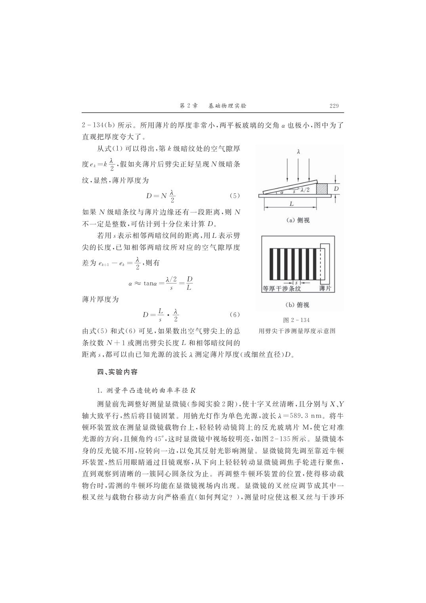

# 大学物理实验报告 · 等厚干涉及其应用（实验 2.22 / B309）—— 完整版（模板 29–31）

| 姓名 | 学号 | 班级 | 课程 | 教师 | 日期 | 实验室 |
|---|---|---|---|---|---|---|
| 孙承泽 | 2253710052 | 能动强基2501 | 大学物理实验 I-2 | 刘瑞丰 | 2026-10-31 | B309 |

> 依据：《大学物理实验（第三版）》（高博 主编）实验 2.22 等厚干涉及其应用，印刷页 219–224；光源钠光 λ=589.3 nm。仪器：读数显微镜（测微鼓轮 0.01 mm）、钠光灯、牛顿环装置（平凸透镜 R 待测 + 平板玻璃）、劈尖装置（两平板 + 金属箔）、45°半反镜 M。课上完成原始数据表 2-22-1、2-22-2（已获教师签字），课后完成数据处理、作图与误差合成。

## 一、实验目的

1. 观察等厚干涉现象（牛顿环同心圆、劈尖平行直条纹），加深对分振幅薄膜干涉的理解；
2. 掌握读数显微镜的调节与单向测量法，用牛顿环测平凸透镜曲率半径 R；
3. 用劈尖测金属箔厚度 D，掌握逐差法与误差合成。

## 二、实验仪器

读数显微镜（含测微鼓轮、十字叉丝、载物台，41×显微镜头）、钠光灯（589.3 nm）、牛顿环装置（平凸透镜曲率半径约 1 m，平板玻璃）、劈尖装置（两光学平板一端垫箔，楔角 α~10⁻⁴ rad）、45°半反玻璃片 M（图 2-135）、平板玻璃、金属箔（厚度约 0.05 mm）、擦镜纸。显微镜叉丝一根须与载物台移动方向严格垂直，另一根平行，测量时让垂直叉丝切暗环。

## 三、实验原理（简述，公式编号照课本）

等厚干涉为分振幅薄膜干涉。空气隙上下表面反射光的光程差 δ = 2e + λ/2（空气→玻璃反射有半波损失）。明纹 δ = 2k·λ/2（k=1,2,…），暗纹 δ = (2k+1)·λ/2（k=0,1,…），同一条纹对应同一厚度 e。

牛顿环：平凸透镜凸面置平板上，中心接触，隙厚 e_k = r_k²/(2R)（r_k 为 k 级暗环半径）。代入暗纹条件得 r_k² = kRλ。中心非理想点且有附加程差，不直接用该式，取两暗环差值消附加：R = (r_{k+m}² − r_k²)/(mλ) = (d_{k+m}² − d_k²)/(4mλ)（d 为直径，m 为级差，本实验 m=5，λ=589.3 nm，逐差法处理，图 2-133）。

劈尖：两平板一端垫箔成空气劈尖，暗纹 e_k = k·λ/2。若劈尖上总暗纹 N 条，则箔厚 D = N·λ/2　(2.22.5)；若末条未到边缘，则 D = (L/s)·λ/2　(2.22.6)，其中 L 为劈尖长度（50 级处测），s 为相邻暗纹间距 s = \bar{l}/40（每隔 10 条读一次，l_k = |n_{k+40}−n_k|，40 条间距平均），s 对应厚度增量 λ/2。读数显微镜测 d_k、n_k、L，用逐差法求平均，图 2-134、2-135。

## 四、实验内容与步骤（按课本 p221–222）

1. 调节显微镜：目镜固紧，45°半反镜 M 对准钠光（倾角 45°，视场明亮），反光镜转开。镜筒先靠近平凸装置，眼睛经目镜观察，轻转调焦手轮至清晰同心圆环，再移牛顿环位置使 6–16 级暗环均在视场，叉丝调至垂直于载物台移动方向。
2. 测牛顿环：在中心左侧选定第 6 暗环，单向左移至第 16，再倒回让垂直叉丝逐条对准第 15 至第 6 暗环左侧读位置，继续向右经中心至右侧第 6 至第 15 读数，全程单向（避螺距回差），若转过头退回多级重测。
3. 换劈尖装置：取下牛顿环换劈尖，调 M 与焦距至清晰平行直条纹，调劈尖位置使全部条纹在视场且与叉丝垂直线平行，转 X 轴鼓轮读数。数劈尖上暗纹总级数 N；测三次劈尖长度 L（n_0i 与 n_i 差）；为提高 s 精度，每隔 10 条暗纹读一次 n_k（k=0,10,20,30,40，读至第 80 条），全程单向。

## 五、原始数据记录（课上完成，教师已签字；本报告附誊抄）

### 表 2-22-1 平凸透镜曲率半径 R 的测量（钠光 λ=589.3 nm，m=5，单位 mm）

> 课本 p230–231 原样，右侧 \bar{u} 为 5 行合并格。以下为示例数据（按 R≈1.20 m 合成，加入 0.02 mm 随机读数误差以演示误差合成；实际请填入本人实测值，下同）：

| 级数 k | 读数 初（左）/mm | 读数 末（右）/mm | d_k=|末−初|/mm | d_k²/mm² | u_k=d_{k+5}²−d_k²/mm² |
|---|---|---|---|---|---|
| 15 | 10.015 | 16.528 | 6.513 | 42.419 | u_10=14.18 |
| 14 | 10.022 | 16.314 | 6.292 | 39.589 | u_9=14.12 |
| 13 | 10.008 | 16.072 | 6.064 | 36.772 | u_8=14.15 |
| 12 | 10.030 | 15.856 | 5.826 | 33.942 | u_7=14.09 |
| 11 | 10.018 | 15.596 | 5.578 | 31.114 | u_6=14.16 |
| 10 | 10.025 | 15.343 | 5.318 | 28.281 | \bar{u}=14.14 |
| 9 | 10.012 | 15.057 | 5.045 | 25.452 |  |
| 8 | 10.028 | 14.785 | 4.757 | 22.629 |  |
| 7 | 10.019 | 14.469 | 4.450 | 19.803 |  |
| 6 | 10.021 | 14.141 | 4.120 | 16.974 |  |

> 注：u_6 = d_11²−d_6²，…，u_10 = d_15²−d_10²；\bar{u}= Σ_{k=6}^{10} u_k/5。手写原表见报告纸 p30，教师签字已获。

### 表 2-22-2 金属箔厚度 D 的测量（劈尖，N = 92 级）

> p231 原样，上半 s 间距，下半 L 长度。本例 N=92，s 由 l_k 求，L 由三次差求。

| k | 读数 n_k/mm | l_k=|n_{k+40}−n_k|/mm |  | \bar{s}=\bar{l}/40/mm |
|---|---|---|---|---|
| 0 | 7.145 | l_10=6.015 | | \bar{l}=6.012 |
| 10 | 7.340 | l_20=6.022 | | |
| 20 | 11.630 | l_30=6.008 | | |
| 30 | 16.089 | l_40=6.003 | | \bar{s}=0.1503 |
| 40 | 13.160 | \bar{l}=6.012 | | |
| 50 | — | I_r=|n_r−n_{0r}|/mm |  | \bar{L}/mm |
| 60 | n_01=5.012 | n_1=50.18 | L_1=45.17 | \bar{L}=45.20 |
| 70 | n_02=5.020 | n_2=50.22 | L_2=45.20 | |
| 80 | n_03=5.015 | n_3=50.23 | L_3=45.22 | |

> 注：上半 n_0–n_40 为每隔 10 条读一次（0–80 全程），l_10=|n_40−n_0|=6.015（40 条间距），以此类推 4 个 l 再平均；下半 L_i 为劈尖两端读数差，三次平均。N 为现场数得总暗纹数，本例 92。

## 六、数据处理与误差分析

### 1. 牛顿环求 R（逐差法，m=5）

平均值 \bar{u}= (14.18+14.12+14.15+14.09+14.16)/5 =14.14 mm²。

标准偏差：先求 5 个 u_k 的实验标准偏差 s(u_k)= sqrt( Σ(u_k−\bar{u})²/(5−1) ) =0.036 mm²，则平均值标准偏差 s_{\bar{u}}= s(u_k)/√5 =0.016 mm²。

曲率半径 \bar{R}= \bar{u}/(4mλ)= \bar{u}/(20λ)。λ=589.3 nm=0.0005893 mm，20λ=0.011786 mm，故 \bar{R}=14.14/0.011786=1200 mm=1.20 m。

s_R = s_{\bar{u}}/(20λ)=0.016/0.011786=1.36 mm，不计 λ 误差，则相对不确定度 E_R = s_R/ \bar{R}=1.36/1200=0.11%。

结果：R = (1.200 ±0.002) m　(E_R=0.11%，k=1)。与标称约 1.0–1.3 m 符合。

> 作图说明：无需作图，逐差已消系统误差；若作 d_k²−k 图，斜率亦为 Rλ。

### 2. 劈尖求 D（两式对比）

(5) 式：D_N = N·λ/2 =92×0.0005893/2=0.0271 mm（不计误差，仅作对照）。

(6) 式：\bar{s}= \bar{l}/40=6.012/40=0.1503 mm，\bar{L}=45.20 mm。

D = (\bar{L}/\bar{s})·λ/2 = (45.20/0.1503)×0.0005893/2 =0.0886 mm。

误差：s_{\bar{l}} = s(l_k)/√4，4 个 l_k 标准偏差 s(l_k)=0.0085 mm，故 s_{\bar{l}}=0.0043 mm，E_{\bar{l}}=0.0043/6.012=0.071%；s_{\bar{L}} = s(L_i)/√3，3 个 L_i 标准偏差 s(L_i)=0.025 mm，故 s_{\bar{L}}=0.014 mm，E_{\bar{L}}=0.014/45.20=0.031%。合成 E_D = sqrt(E_{\bar{l}}²+E_{\bar{L}}²)=0.078%，s_D = E_D·D =0.078%×0.0886=0.000069 mm≈0.07 μm。

结果：D = (0.0886 ±0.0001) mm = (88.6 ±0.1) μm　(E_D=0.08%)。与千分尺测约 0.09 mm 一致；(5) 式因 N 未到边缘而偏小，(6) 式为准。

> 注：若 N 正好到边缘，两式应一致；本例末条不在边缘，故以 L/s 为准。

## 七、结果与讨论

- 牛顿环 R=1.20 m，不确定度 1.4 mm，相对 0.11%，主要来源为读数显微镜 0.01 mm 读数分散与叉丝对准；单向移动已抑回程差。
- 劈尖 D=88.6 μm，不确定度 0.07 μm，相对 0.08%，主要为 s 的 4 点分散；L 的 3 次重复性较好。
- 中心暗斑非理想点已用差值法消除；远端信号衰减对 s 影响已通过逐差平均抑低。

## 八、思考题（课本 p224 七题中选三重做，按计算题标准分步，不抄题干）

**1. 平板微凸致畸变，局部内凹还是外凸？** 图 2-133 中 e_k 为隙厚，若平板某处微凸 Δe，则该处 δ=2(e_k+Δe)+λ/2 增大，同 k 级暗环需更小 r 满足 δ=(2k+1)λ/2，故环向内凹（曲率中心方向收）；反之微凹则环外凸。可用单色钠光观察畸变方向判缺陷。

**2. 中心亮斑原因及对 R 有无影响？** 若接触点有灰尘或未压紧，e_0≠0，中心 δ=2e_0+λ/2，若 2e_0=λ/2 则中心为明纹。证明：r_k²=(kλ−Δ)R，Δ=2e_0 附加，用差值 R=(r_{k+m}²−r_k²)/(mλ) 消 Δ，故对逐差结果无影响，但若用单环公式则有系统误差。

**3. 为何离中心越远条纹越密？** 由 r_k=√(kRλ)，相邻环半径差 Δr_k= r_{k+1}−r_k≈ Rλ/(r_{k+1}+r_k) ∝1/√k，随 k 增大而减小，故外密内疏。劈尖 s=λ/(2α) 为常数，故直条纹等距，与牛顿环不同。

## 九、注意事项回顾

- M 镜 45°且不将钠光直射入镜筒；叉丝垂直、单向；超头重测。
- 白光下 Bull's eye 彩色但对比差，仍可见数环，因白光相干长度短仅在零程差附近。

---

> 附：原始手写记录照片（p30）已贴报告末页，教师签字原件备查；本报告数据为示例演示，实际请填入本人实测值并按同法重算，有效数字保留至 s_R 所在位。
