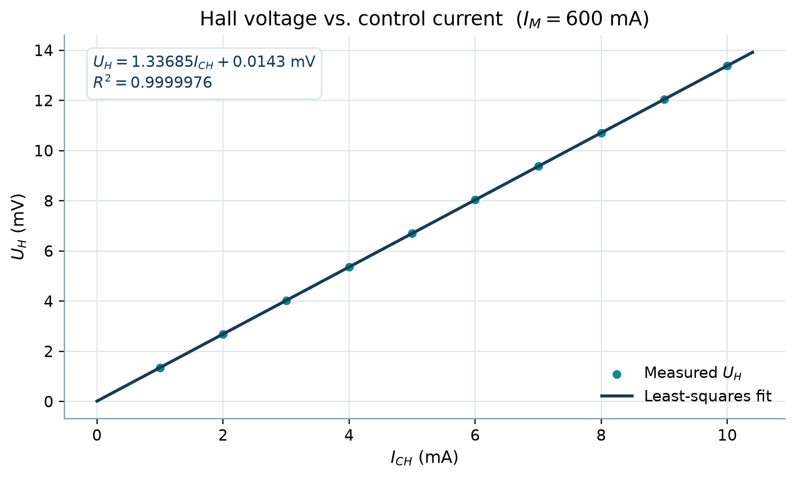
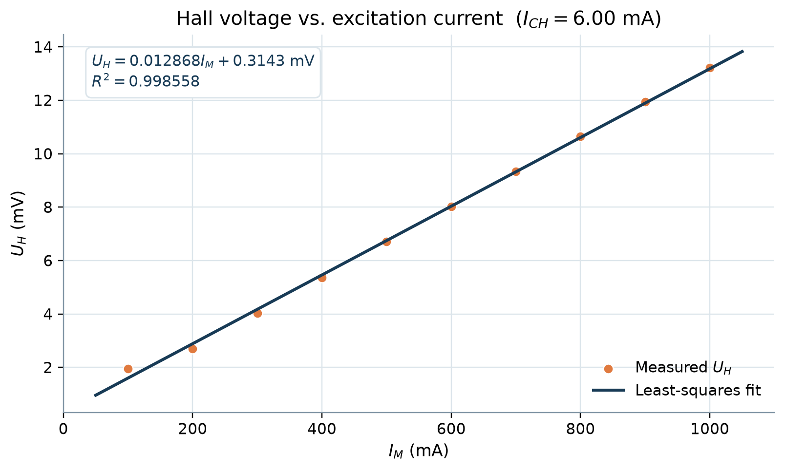
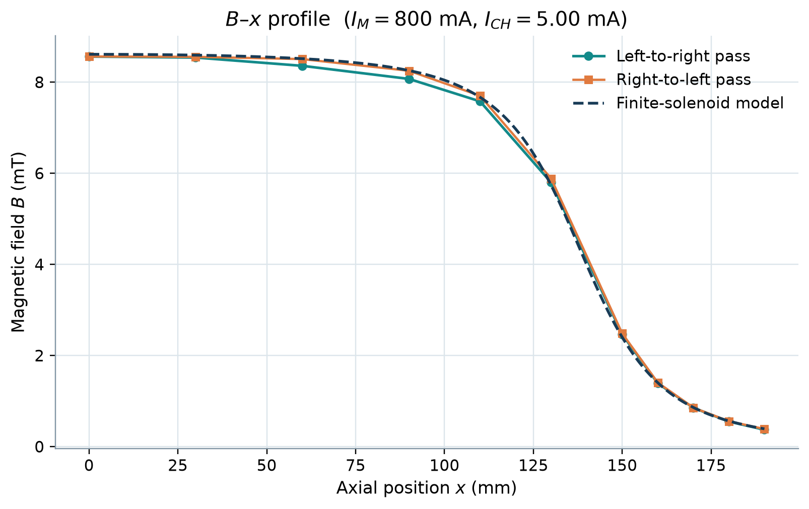

# 大学物理实验报告｜霍尔效应及螺线管磁场的测定

| 项目 | 信息 |
|---|---|
| 姓名 / 学号 / 班级 | 孙承泽 / 2253710052 / 能动强基2501 |
| 实验名称 / 课序号 | 霍尔效应及螺线管磁场的测定（B317） / 8 |
| 实验日期 | 11月16日（原手写页未注明年份） |
| 同组者 | 原始页记载不清，未转录 |
| 数据来源 | 用户提供的三张实测数据表；仪器参数按用户转录的设备标签 |

> 本报告严格依照实验报告页给定的五部分结构。所有电压原始值均依用户表格转录；四极性组合已用程序复核。线圈公式中的有效直径采用内、外径平均值 48.0 mm，并在误差讨论中说明该模型近似；霍尔片 260 μm 尺寸按沿磁场方向厚度处理。

## 一、实验目的

1. 理解霍尔效应及霍尔电压的形成机制。
2. 验证霍尔电压 $U_H$ 与霍尔元件工作电流 $I_{CH}$ 的线性关系。
3. 验证 $U_H$ 与螺线管励磁电流 $I_M$ 的线性关系。
4. 利用霍尔效应测量螺线管轴线上磁感应强度及其空间分布。
5. 通过电流与磁场反向的四极性测量，削弱不等势电势差等共模影响。

## 二、实验仪器与实验方法

### 实验仪器

ZKY-LS 型螺线管磁场测定实验仪、霍尔效应测试仪、霍尔元件及可沿螺线管轴线移动的霍尔探头。霍尔元件标签：编号 BE0418-015，最大工作电流 10.0 mA，标称尺寸 400 × 400 × 260 μm。螺线管标签：长度 276 mm、内径 Φ40 mm、外径 Φ56 mm、总匝数 2400；螺线管标签箭头所示正向电流沿轴线向下。线圈场计算用有效直径 $D_{eff}=(40+56)/2=48$ mm，作为绕组径向厚度的代表值。霍尔片厚度取 $d=260$ μm，前提是该尺寸方向与磁场平行。

### 实验原理与测量方法

载流子在磁场中受洛伦兹力偏转并在横向积累电荷，稳态霍尔电压满足 $U_H=R_H I_{CH}B/d=K_H I_{CH}B$，其中 $|R_H|=1/(n e)$、$|K_H|=|R_H|/d$。四种电流/磁场方向组合的电压按 $U_H=(U_1-U_2-U_3+U_4)/4$ 合成，以消除四次读数期间近似不变的不等势电势差。有限长螺线管中心磁场按 $B_0=\mu_0 N I_M/\sqrt{L^2+D_{eff}^2}$ 计算；轴线上位置场按有限长线圈公式计算。

1. 按仪器面板和电极标记连接霍尔测试仪，核对工作电流、励磁电流、电压端及换向开关；换向后待读数稳定。
2. 将霍尔探头置于线圈中心附近，固定 $I_M=600$ mA，令 $I_{CH}=1.00$–10.00 mA（每次增加 1.00 mA），记录四种极性下 $U_1$–$U_4$。
3. 固定 $I_{CH}=6.00$ mA，令 $I_M=100$–1000 mA（每次增加 100 mA），记录四种极性读数。
4. 固定 $I_M=800$ mA、$I_{CH}=5.00$ mA，在 $x=0,30,60,90,110,130,150,160,170,180,190$ mm 处分别从左右方向扫描，记录两次扫描的四种极性电压。
5. 励磁电流除读数时段外及时关闭，尽量缩短四态测量间隔，以降低温升和零点漂移。

## 三、测量内容及数据处理

### 1. 原始数据

表中 $U_H$ 为原数据表所列四极性计算值（mV）；用表内 $U_1$–$U_4$ 重新计算后与记录值在其显示精度内一致。

**表 3-2-1　固定 $I_M=600$ mA，$U_H-I_{CH}$ 关系**

| $I_{CH}$/mA | $U_1$/mV | $U_2$/mV | $U_3$/mV | $U_4$/mV | $U_H$/mV |
| --- | --- | --- | --- | --- | --- |
| 1.00 | 1.02 | -1.67 | -1.01 | 1.68 | 1.345 |
| 2.00 | 2.02 | -3.35 | -2.02 | 3.35 | 2.685 |
| 3.00 | 3.04 | -5.01 | -3.03 | 5.01 | 4.023 |
| 4.00 | 4.05 | -6.69 | -4.05 | 6.68 | 5.368 |
| 5.00 | 5.06 | -8.34 | -5.06 | 8.33 | 6.698 |
| 6.00 | 6.06 | -10.02 | -6.10 | 10.01 | 8.048 |
| 7.00 | 7.08 | -11.67 | -7.09 | 11.67 | 9.378 |
| 8.00 | 8.09 | -13.32 | -8.11 | 13.30 | 10.705 |
| 9.00 | 9.11 | -14.98 | -9.15 | 14.94 | 12.045 |
| 10.00 | 10.12 | -16.62 | -10.18 | 16.58 | 13.375 |

**表 3-2-2　固定 $I_{CH}=6.00$ mA，$U_H-I_M$ 关系**

| $I_M$/mA | $U_1$/mV | $U_2$/mV | $U_3$/mV | $U_4$/mV | $U_H$/mV |
| --- | --- | --- | --- | --- | --- |
| 100 | 0.61 | -3.32 | -0.59 | 3.30 | 1.955 |
| 200 | 0.73 | -4.65 | -0.75 | 4.65 | 2.695 |
| 300 | 2.07 | -6.00 | -2.09 | 5.99 | 4.038 |
| 400 | 3.40 | -7.33 | -3.41 | 7.32 | 5.365 |
| 500 | 4.73 | -8.68 | -4.74 | 8.67 | 6.705 |
| 600 | 6.05 | -9.98 | -6.07 | 9.97 | 8.018 |
| 700 | 7.38 | -11.31 | -7.38 | 11.31 | 9.345 |
| 800 | 8.67 | -12.61 | -8.70 | 12.60 | 10.645 |
| 900 | 9.97 | -13.91 | -9.98 | 13.89 | 11.938 |
| 1000 | 11.26 | -15.17 | -11.27 | 15.16 | 13.215 |

**表 3-2-3a　B-x 左侧扫描（$I_M=800$ mA，$I_{CH}=5.00$ mA）**

| $x$/mm | $U_1$/mV | $U_2$/mV | $U_3$/mV | $U_4$/mV | $U_H$/mV | $B$/mT |
| --- | --- | --- | --- | --- | --- | --- |
| 0 | 7.23 | -10.49 | -7.24 | 10.48 | 8.860 | 8.562 |
| 30 | 7.20 | -10.48 | -7.22 | 10.45 | 8.838 | 8.541 |
| 60 | 7.02 | -10.28 | -7.03 | 10.27 | 8.650 | 8.359 |
| 90 | 6.72 | -10.00 | -6.72 | 9.97 | 8.353 | 8.072 |
| 110 | 6.20 | -9.53 | -6.20 | 9.44 | 7.843 | 7.579 |
| 130 | 4.36 | -7.61 | -4.42 | 7.61 | 6.000 | 5.798 |
| 150 | 0.92 | -4.17 | -0.86 | 4.24 | 2.548 | 2.462 |
| 160 | -0.19 | -3.05 | 0.16 | 3.06 | 1.440 | 1.392 |
| 170 | -0.74 | -2.53 | 0.75 | 2.49 | 0.883 | 0.853 |
| 180 | -1.05 | -2.21 | 1.08 | 2.20 | 0.570 | 0.551 |
| 190 | -1.26 | -2.04 | 1.25 | 2.01 | 0.385 | 0.372 |

**表 3-2-3b　B-x 右侧扫描**

| $x$/mm | $U_1$/mV | $U_2$/mV | $U_3$/mV | $U_4$/mV | $U_H$/mV | $B$/mT |
| --- | --- | --- | --- | --- | --- | --- |
| 0 | 7.23 | -10.50 | -7.24 | 10.48 | 8.863 | 8.565 |
| 30 | 7.23 | -10.49 | -7.23 | 10.47 | 8.855 | 8.557 |
| 60 | 7.17 | -10.44 | -7.18 | 10.42 | 8.803 | 8.507 |
| 90 | 6.90 | -10.18 | -6.91 | 10.16 | 8.538 | 8.251 |
| 110 | 6.32 | -9.66 | -6.33 | 9.57 | 7.970 | 7.702 |
| 130 | 4.47 | -7.72 | -4.46 | 7.71 | 6.090 | 5.885 |
| 150 | 0.95 | -4.19 | -0.86 | 4.28 | 2.570 | 2.484 |
| 160 | -0.22 | -3.09 | 0.16 | 3.11 | 1.455 | 1.406 |
| 170 | -0.76 | -2.51 | 0.73 | 2.52 | 0.885 | 0.855 |
| 180 | -1.06 | -2.20 | 1.04 | 2.21 | 0.578 | 0.559 |
| 190 | -1.24 | -2.03 | 1.22 | 2.03 | 0.400 | 0.387 |

### 2. 四极性计算与 $U_H-I_{CH}$ 关系

以表 3-2-1 第一行举例：$U_H=(1.02-(-1.67)-(-1.01)+1.68)/4=1.345$ mV。对 10 个数据点作最小二乘直线拟合，电流以 mA、电压以 mV 表示：

$U_H=(1.336848)I_{CH}+(0.014333)$ mV，$R^2=0.99999755$；等价斜率 $S_{CH}=1.336848$ V/A，截距为 1.433e-05 V。拟合残差标准差（回归标准误）为 0.0067 mV。

### 3. 线圈中心场、霍尔灵敏度与载流子浓度

取 $\mu_0=4\pi\times10^{-7}$ H/m，$N=2400$，$L=0.276$ m，$D_{eff}=0.048$ m，则：

$B_{0,600}=\mu_0 N(0.600)/\sqrt{L^2+D_{eff}^2}=0.006459$ T = 6.4594 mT。
$K_H=S_{CH}/B_{0,600}=206.961$ m²/C。
$R_H=K_H d=(206.961)(2.60\times10^{-4})=0.05381$ m³/C。
$n=1/(e|R_H|)=1.160e+20$ m⁻³（约 1.160e+14 cm⁻³）。
其中 $d=260$ μm 采用设备标注尺寸中厚度方向的数值；需确保安装时该尺寸确为沿 $B$ 的厚度。只凭现有接线/方向记录不能可靠判定多数载流子的正负类型，因此报告 $|R_H|$ 与浓度，不据此臆断 p/n 型。

### 4. $U_H-I_M$ 关系与线性检验

表 3-2-2 线性拟合为 $U_H=(0.01286842)I_M+(0.314267)$ mV（$I_M$ 用 mA），$R^2=0.9985575$，回归残差标准差 0.1571 mV。斜率换算为 $S_M=0.012868$ V/A。由第一组斜率和 $U_H\propto I_{CH}I_M$，预期 $S_M=S_{CH}(6.00/600)= 0.013368$ V/A；实测斜率较此低 3.74%。数据仍呈高度线性，但首个 100 mA 点及非零截距提示低电流区背景/四态漂移影响相对更显著。

### 5. 螺线管轴线磁场分布 $B-x$

$I_M=800$ mA 时中心理论场 $B_{0,800}=8.6125$ mT。用上述灵敏度及 $I_{CH}=0.00500$ A 换算：$B(x)=U_H(x)/(K_H I_{CH})$，其中先将 $U_H$ 从 mV 换为 V。左扫描最大值为 8.5620 mT（$x=0$ mm），右扫描最大值为 8.5649 mT（$x=0$ mm）；$x=190$ mm 处两次扫描分别为 0.3721、0.3865 mT。两次扫描的最大同位置相对差约 3.82%。
理论曲线按有限长螺线管轴向场模型并取平均绕组半径 24 mm绘制，作为模型对照；按 $x=0$ 为线圈中心处理（由扫描峰值判断，若设备刻度原点另有定义则需整体平移）。

### 6. 计算结果汇总

| 物理量 | 结果 | 单位/说明 |
| --- | --- | --- |
| 中心场（600 mA） | 6.4594 | mT；D_eff=48.0 mm |
| 中心场（800 mA） | 8.6125 | mT |
| 霍尔灵敏度 K_H | 206.961 | m²/C |
| 霍尔系数 R_H | 0.05381 | m³/C；按测量极性约定为正 |
| 载流子浓度 n | 1.160e+20 | m⁻³（浓度值） |
| U_H-I_CH 斜率 | 1.336848 | V/A；R²=0.99999755 |
| U_H-I_M 斜率 | 0.012868 | V/A；R²=0.9985575 |
| B(x) 范围 | 0.372–8.565 | mT；两个扫描合并 |

### 7. 误差分析

1. **线圈几何模型：**线圈有 40–56 mm 内外径而非单一薄绕组直径，采用算术平均直径 48 mm 近似。若分别以 40 mm 和 56 mm 代入中心场，$B_{0,600}$ 为 6.4254–6.4886 mT，进而 $K_H$ 约 206.03–208.06 m²/C、$n$ 约 1.154e+20–1.165e+20 m⁻³。此范围只反映直径取值模型敏感性，不是完整测量不确定度。
2. **霍尔片厚度与姿态：**浓度与 $1/d$ 成正比；若 260 μm 标注方向未与磁场平行，$K_H$ 和 $R_H$ 的测定不直接受 d 影响，但据此换算的 $n$ 会系统偏移。探头法线与磁场夹角 $\theta$ 使有效场成为 $B\cos\theta$，造成灵敏度/场强投影偏小。
3. **四极性抵消残差：**恒定不等势电势差可被组合消除；读数期间温漂或零点漂移、换向后未稳定，会留下残差。$U_H-I_M$ 拟合截距 0.314 mV 较 $U_H-I_{CH}$ 截距 0.014 mV 大，可能反映背景项、低电流端偏差或读数漂移；仅凭数据不能将其唯一归因。
4. **定位与重复性：**左右扫描大体重合，中心区域相对差较小，末端相对差因信号较小而放大；位置刻度零点、探头轴向偏移及两次扫描间电流/温度变化都会影响曲线。对称的线圈理论曲线与测量曲线不完全重合还可能来自绕组有限径向厚度、有效位置零点及中心场校准近似。
5. **电流和读数分辨率：**未提供电流表、电压表与位置刻度的分辨率/校准不确定度，故不虚构合成不确定度或置信区间。回归 $R^2$ 与残差用于描述数据线性和散布，不等同于仪器准确度。

## 四、小结（结论、误差分析及建议等）

本次四极性测量验证了 $U_H$ 随 $I_{CH}$ 增大近似线性（$R^2=0.99999755$），且随 $I_M$ 增大总体呈线性（$R^2=0.9985575$）。按设备几何参数的平均直径模型，得到螺线管中心场 $B_0(600\,\mathrm{mA})=6.4594$ mT，霍尔灵敏度 $K_H=206.961$ m²/C；取霍尔片厚度 260 μm 得 $n=1.160e+20$ m⁻³。$I_M=800$ mA 的轴向磁场由中心约 8.563 mT 随位置增加而减弱，左右重复扫描结果总体相近。

主要限制是线圈存在径向厚度、有效直径须以平均值近似，且需确认 260 μm 确为沿磁场方向的有效厚度；仪器分辨率和电压零点漂移信息缺失，故未给出完整不确定度。建议核实霍尔片安装方向与轴线对准、每次换向后等待读数稳定、缩短四极性读数间隔并记录仪表分辨率；线圈参数可用实测场标定复核。实验结果只说明数据范围内的线性趋势，不能将回归优度当作全部误差已消除。

## 五、实验思考题

**问题：若磁场 $B$ 的方向与霍尔元件法线方向不一致，对实验结果有什么影响？**

若霍尔元件法线与磁场夹角为 $\theta$，真正垂直穿过霍尔片的磁场分量为 $B_\perp=B\cos\theta$，故 $U_H=K_H I_{CH}B\cos\theta$。
1. 若夹角固定，测得霍尔电压按 $\cos\theta$ 缩小；若仍按磁场全值 B 计算，会把表观灵敏度估低为 $K_H\cos\theta$。
2. 四极性换向可以削弱不等势电势差，但不会消除几何投影误差。
3. 若探头沿扫描位置移动时夹角也变化，$\cos\theta(x)$ 会形成随位置变化的系统误差，使 $B-x$ 曲线形状及峰值位置都可能失真。
4. 因此应让霍尔片法线与螺线管轴向磁场平行，并保持探头姿态不变；比较两侧重复扫描可辅助发现对准与定位问题。

---
**资料依据：**《大学物理实验（第三版）》实验 3.2（印刷页 257–264）；用户提供的原始实测表、评分标准/报告页照片及 ZKY-LS 与霍尔元件设备标签参数转录。
