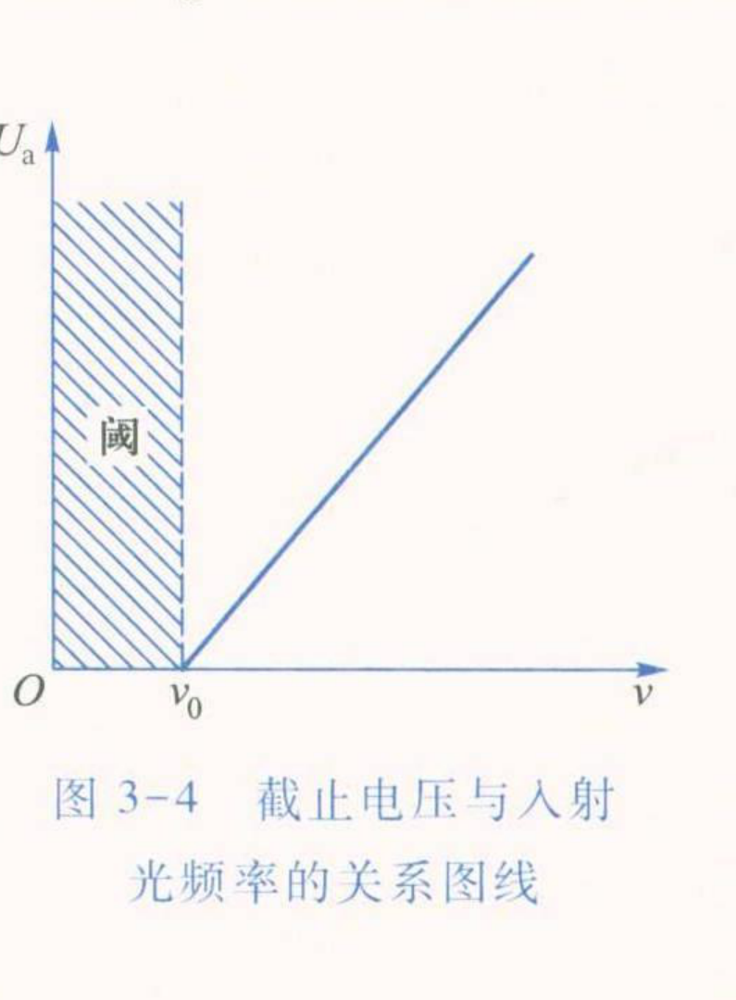
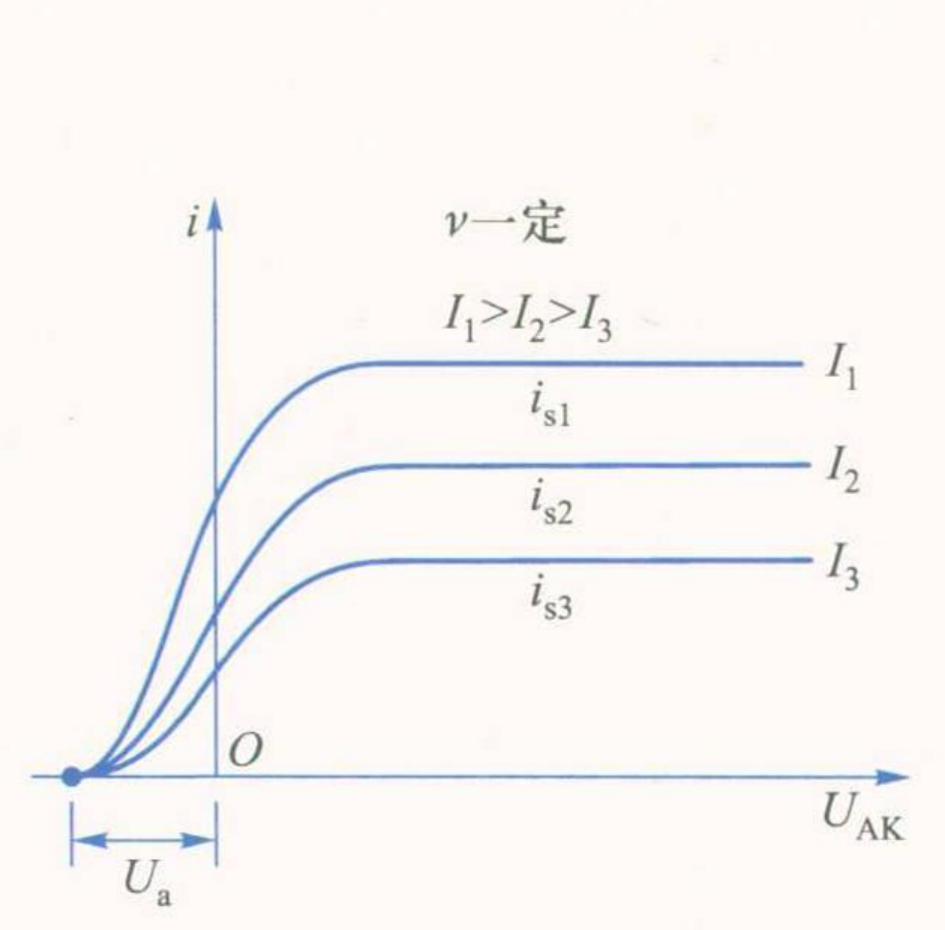
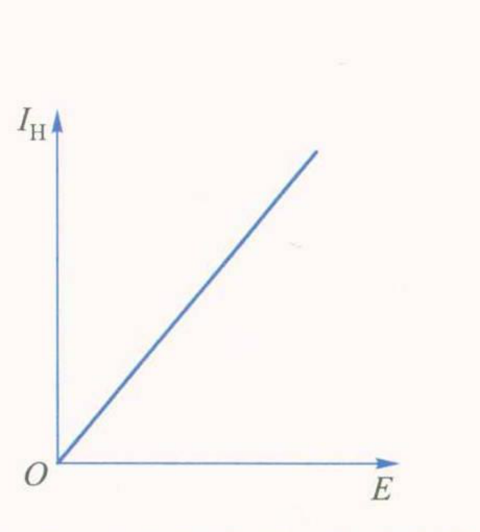

# 大学物理实验预习报告 · 光电效应及普朗克常量的测定（实验 3.1 / B320）

| 姓名 | 学号 | 班级 | 课程 |
|---|---|---|---|
| 孙承泽 | 2253710052 | 能动强基2501 | 大学物理实验 I-2 |

> 依据：《大学物理实验（第三版）》（高博 主编）实验 3.1，印刷页 251–257。

## 一、实验原理简述

光电子最大初动能满足 hν=W+½mvₘ²，反向遏止电压满足 eUₐ=½mvₘ²，因此 Uₐ=(h/e)(ν−ν₀)，ν₀=W/h。测多种频率对应的遏止电压并作直线，以斜率求普朗克常量 h。固定频率时，饱和光电流随入射光强变化。

## 二、预习思考题与解答

**1. 为什么要测多个频率的遏止电压并作 Uₐ−ν 直线，才能求普朗克常量？直线的斜率和截距各包含什么物理信息？**

依据：光电子最大初动能由光子能量扣除逸出功得到，课本式（3.1.2）为 hν=½mvₘ²+W；遏止电压满足式（3.1.1）eUₐ=½mvₘ²。

推导：联立两式，得 Uₐ=(h/e)ν−W/e。由阈频定义 ν₀=W/h，可改写为 Uₐ=(h/e)(ν−ν₀)（3.1.3）。因此 Uₐ−ν 图线斜率 K=h/e，已知 e 后 h=eK；横轴截距为 ν₀，纵轴截距为 −W/e。多个波长给出多个点，线性拟合可利用整组数据确定斜率，而非让单次遏止电压读数直接决定 h。

结论：用不同频率的光建立 Uₐ−ν 直线，可由斜率测 h、由横轴截距得阈频 ν₀，并据 W=hν₀ 联系逸出功。

**2. 暗电流、本底电流和反向电流会怎样影响从伏安曲线读遏止电压？课本为什么认为零电流法仍可用于求 h？**

依据：课本指出，光电管存在暗电流、本底电流和反向电流，反向截止电压附近的电流不一定降为零；伏安曲线拐点因此不等于理想情况下与横轴的交点。

推导：反向电压增大时，光电子逐渐被阻止到达阳极，光电流下降；但暗电流、本底电流及阳极受光引起的反向电流使实测电流基线偏离零，且随电压变化。实验采用“零电流法”：对每条谱线调节电压，记录仪器显示电流为零时 Uₐₖ 的绝对值作为遏止电压 Uₐ。该方法以前述几种寄生电流都很小为前提；课本说明各谱线所测遏止电压之间的差值对拟合斜率影响不大。

结论：不能把实际曲线简单外推到横轴交点当作精确遏止电压；按课本零电流法读数，并控制暗电流、本底电流和反向电流较小，可得到用于 Uₐ−ν 拟合的近似值。

**3. 为什么测光电管的光电特性时固定 λ 和 Uₐ、改变光阑直径；测 h 时又固定光阑、改用不同波长？这两组实验分别检验什么关系？**

依据：实验步骤分别规定：测光电特性时用 λ=577 nm、Uₐ=25 V，改变 d=2、4、8 mm 并记录 I_H；测 h 时固定 d=4 mm，使用五种滤色片测遏止电压。课本指出 I_H 与光强成正比，并给出 Uₐ=(h/e)(ν−ν₀)。

推导：第一组保持频率与阳极电压不变，只改变光阑直径；圆形光阑面积正比于 d²，故以 d² 作为光强变化量，检验 I_H 与光强是否成正比。第二组固定光阑以保持光路几何条件不变，换用滤色片改变频率 ν，测得对应 Uₐ 后作图拟合斜率；不假定各滤色片的光强相同。由光电效应方程，最大初动能及 Uₐ 随 ν 变化，而非由光强决定。

结论：两组测量通过分别控制光频率、光阑条件，区分光强对光电子数量（饱和电流）的影响与频率对最大初动能（遏止电压）的影响；五个波长数据用于求 h 的线性斜率。
