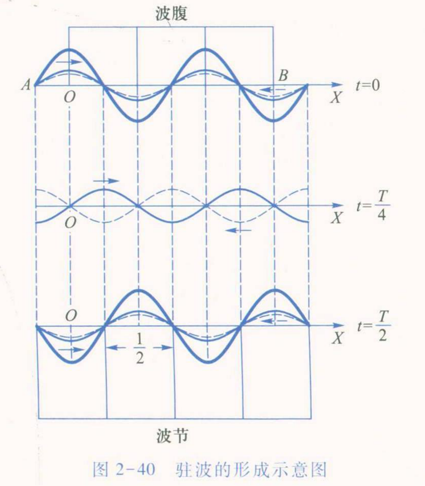
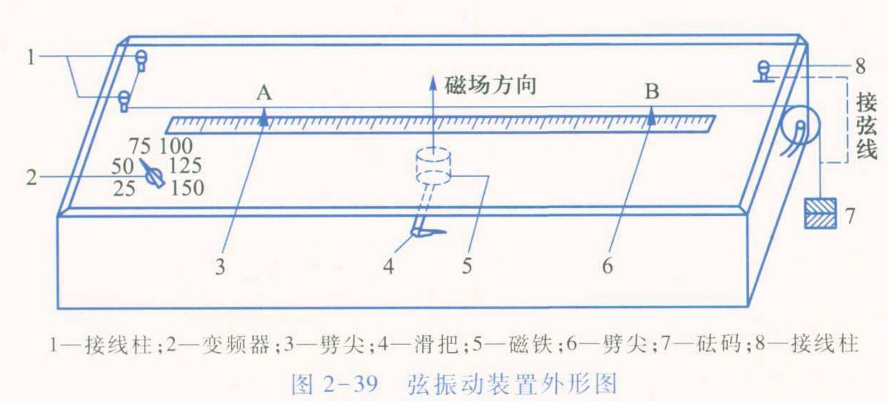

# 大学物理实验预习报告 · 固定均匀弦振动的研究（实验 2.7 / B321）

| 姓名 | 学号 | 班级 | 课程 |
|---|---|---|---|
| 孙承泽 | 2253710052 | 能动强基2501 | 大学物理实验 I-2 |

> 依据：《大学物理实验（第三版）》（高博主编）实验 2.7，印刷页 96–101。

## 一、实验原理简述

**1. 驻波的形成与波节、波腹**

弦线上入射波和反射波频率、振幅相同，沿同一直线相向传播。以两波振动相位始终相同的点为坐标原点，设单列波振幅为 A、频率为 f、波长为 λ，则两波及其叠加为：

y₁ = A cos 2π(ft − x/λ)，y₂ = A cos 2π(ft + x/λ)

y = y₁ + y₂ = 2A cos(2πx/λ) cos(2πft)　（2.7.1）

弦上各点均以频率 f 振动，但振幅 2A|cos(2πx/λ)| 随位置变化。振幅为零处是波节，振幅最大处是波腹；由式（2.7.1）可得：

波节：x = (2k + 1)λ/4；波腹：x = kλ/2　（2.7.2、2.7.4）

这里 k 取整数；相邻波节间距和相邻波腹间距均为 λ/2，其中相邻波节间距见式（2.7.3）。波节位置固定不动，是驻波的重要特征。

**2. 固定端条件与波速**

两劈尖处为波节，弦长 l 中须包含整数 n 个半波长，n 为驻波段数，故

l = nλ/2，λ = 2l/n　（2.7.5）

弦线张力为 Fₜ、线密度为 ρ 时，横波传播速度由弦的性质决定；结合 v=fλ，得

v = √(Fₜ/ρ)　（2.7.6）；v = 2fl/n　（2.7.7）

f = [n/(2l)]√(Fₜ/ρ)　（2.7.8）

可见 l、Fₜ、ρ 给定时，只有满足式（2.7.8）的频率才能形成相应的固定端驻波。

**3. 测量方法**

交流电流通过处于磁场中的弦线，交变安培力驱动弦振动；移动劈尖调节弦长，使驻波稳定后读取两端位置，l=l_B−l_A。先在 f=100 Hz、悬挂 40.0 g 砝码时，分别测 n=1、2、3 的弦长，由式（2.7.8）求出 ρ=Fₜ[n/(2fl)]² 并取平均。再分别固定频率、改变砝码和固定砝码、改变频率，测 n=1、2 对应弦长，以 λ̄=(λ₁+λ₂)/2 计算实测波速 fλ̄，并与 √(Fₜ/ρ̄) 比较。

## 二、预习思考题与解答

**1. 同一频率、同一张力下，单段和两段驻波的弦长如何用于互相校验？若误数波段，会对结果造成什么影响？**

依据：两劈尖处为波节，相邻波节间为一个波段，长度为 λ/2；课本式（2.7.5）给出 λ=2l/n。n 是半波数，不是内部波节数。

推导：频率 f、张力 Fₜ 和线密度 ρ 相同时，v=√(Fₜ/ρ) 不变，所以 λ=v/f 不变。单段时 λ₁=2l₁；两段时 λ₂=2l₂/2=l₂。因此理想情况下 l₂=2l₁，且 λ₁=λ₂。课本表 2-7-2、2-7-3 用 λ̄=(λ₁+λ₂)/2，再算实测波速 v实=fλ̄。实际应先比较两次结果是否相近，再取平均；若差距明显，应检查波形、波段计数和两劈尖读数，平均不能消除共同系统偏差。

例如同一个两段驻波若误记为 n=1，则计算的波长为 2l₂，是真值 l₂ 的两倍；相同频率下计算的波速也变为两倍。若据此反算 ρ=Fₜ/v²，线密度则变为正确值的四分之一。

结论：单段与两段是对同一波长的两次测量，可相互核对；必须数两端波节之间的波段，并以 l=l_B−l_A 确定弦长。

**2. 在频率固定时逐级增加砝码，怎样用测得的驻波数据检验波速与张力的关系？如果线密度用错，比较结果会怎样变化？**

依据：课本式（2.7.6）为 v=√(Fₜ/ρ)，式（2.7.7）为 v=2fl/n。课本先在 f=100 Hz、40.0 g 砝码下分别测 n=1、2、3 的弦长求 ρ₁、ρ₂、ρ₃，再取平均 ρ̄；随后固定 f=75 Hz，使砝码从 30.0 g 至 55.0 g 每次增加 5.0 g，每档测 n=1、2 的驻波。

推导：各档用 Fₜ=mg，按 λ₁=2l₁、λ₂=l₂ 计算平均波长，再得 v实=fλ̄。由已测 ρ̄ 算比较值 v理=√(Fₜ/ρ̄)，按课本表格算相对偏差 Eᵣ=|v理−v实|/v理×100%。在同一根均匀弦上，理论式改写为 v理²=Fₜ/ρ̄；若测量可靠，v实² 随 Fₜ 近似线性增长，斜率应接近 1/ρ̄。

若所用 ρ̄ 偏大，v理按平方根关系偏小；偏小则 v理偏大。它会同时影响各档比较，而不是每档的 v实=fλ̄；因此不能仅凭多档平均消除这一共同影响。改变砝码后应等其稳定、调整弦长并待波形稳定再读数。

结论：固定频率、改变张力，利用 v实² 与 Fₜ 的关系及其与 v理的比较，可检验张力对波速的影响；线密度的测量准确性影响整组理论比较。

**3. 固定砝码后改变驱动频率，为什么需要重新调整弦长？这组数据能否说明波速由频率决定？磁铁应放在哪里？**

依据：课本将 40.0 g 砝码挂于弦线一端，依次取 f=75、100、125、150 Hz；每个频率均调节弦长使出现 n=1、2 的驻波。课本式（2.7.8）为 f=[n/(2l)]√(Fₜ/ρ)，磁铁应在两劈尖之间且不能处于波节位置。

推导：同一弦、同一砝码下，近似认为 Fₜ 和 ρ 不变，因此 v理=√(Fₜ/ρ) 不变。对固定波段数 n，由式（2.7.8）得 l=nv理/(2f)；例如频率从 75 Hz 增至 150 Hz，理想的同一 n 所需弦长减为原来的一半。若不调弦长，原先的固定端驻波条件一般不再与新频率匹配。

每档分别测出 l₁、l₂，算 λ̄=(2l₁+l₂)/2 和 v实=fλ̄；理想情况下 f 增大时 λ̄ 随之减小，使乘积保持不变。各档实测值存在差别时，应先考虑读数、波形稳定和张力条件等影响，不能直接把差别认定为频率改变了波速。

磁铁提供磁场，通有交流电的弦线在磁场中受到交变安培力而振动。将磁铁放在两劈尖之间且避开波节，有利于驱动该段弦的振动；通过滑把调节磁铁位置并等波形稳定后再读数。

结论：固定张力时须随频率调整弦长以取得相应驻波；理想均匀弦的波速由张力与线密度决定，不由频率单独决定。
