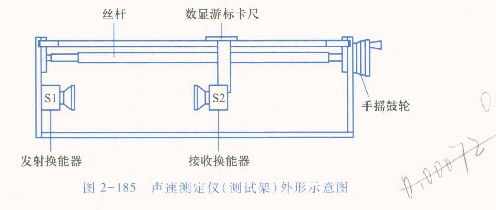
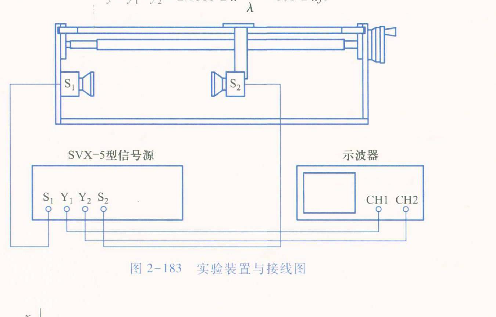
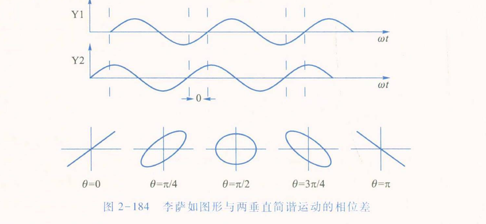

# 大学物理实验预习报告 · 声速的测定（实验 2.27 / B312）

| 姓名 | 学号 | 班级 | 课程 |
|---|---|---|---|
| 孙承泽 | 2253710052 | 能动强基2501 | 大学物理实验 I-2 |

> 依据：《大学物理实验（第三版）》（高博 主编）实验 2.27 声速的测定，印刷页 246–250。

## 一、实验原理简述

空气中声速 v = sqrt(γRT/M)　(2.27.1)，γ=c_p/c_V，R 摩尔气体常量，M 摩尔质量，T 热力学温度。0℃时 v0 = sqrt(γRT0/M)=331.45 m/s，t℃时 v_t = v0 sqrt(1+t/273.15)　(2.27.2)，温度为主要影响因素。波动有 v = f λ　(2.27.3)，知 f、λ 可求 v，f 由低频信号发生器输出即声波频率。先以 y–t 模式使 S1–S2 距 5 cm，调信号频率使接收正弦幅最大即谐振频率 f0，测 3 次平均，f0 即工作频率。本实验以超声（2×10⁴~5×10⁸ Hz，波长短、方向性好）为波源，用 SV-DH 型测试架（S1 固定发射、S2 丝杆+数显尺可移）配合 SVX-5 信号源与示波器，以驻波法、行波法、时差法三法测 λ 或直接测 v。驻波法：S1 平面波经 S2 反射叠加形成驻波 y = 2A cos 2π x/λ · cos 2π ft，波腹 |cos 2π x/λ|=1 → x = ±n λ/2，波节 x = ±(2n+1)λ/4，相邻波腹/波节距 λ/2，移 S2 逐差测 10 个波腹间距求 λ。行波法：S1 与 S2 处波相位差 φ = 2π l/λ　(2.27.6)，l 每变 λ 则 φ 变 2π，示波器 X–Y 李萨如图形周期重复即 2π，逐差测 10 个 λ 求 v。时差法：连续波经脉冲调制发射，v = l/t，单片机计时 8 位有效位，随机测量，等间隔测 10 组 L_i、t_i 逐差求 v，三法均与温度理论值比对。

## 二、预习思考题与解答

**1. 为何必须先以 y–t 模式将 S1–S2 距置 5 cm，从小到大调频率使接收正弦幅最大来定谐振频率 f0，且要测 3 次平均？f0 不准对 v 有何影响？**

① 依据：换能器为压电陶瓷，其电–声转换效率随频率呈共振峰，峰值处即机械共振频率，发射最强、接收最灵敏。超声声场由 S1 发出的近似平面波与 S2 反射波叠加成驻波，幅值 y = 2A cos 2π x/λ · cos 2π ft，接收电压正比于 2A|cos 2π x/λ|，只有在系统谐振时 A 最大，示波器上正弦幅度才最大，此时波腹位置信号变化最陡峭，极大位置最易判读；偏离谐振时 A 下降，沿 x 的幅值起伏变得平坦，波腹不清晰，逐差的 xi 误差增大。

② 步骤与防错：按图 2-183 接线，示波器置 y–t，S1–S2 先调至约 5 cm（太近近场干扰多、信号非平面波；太远信号已衰减），发射强度适中，从最小频率向上细调，同时观察输出波形直至幅值最大，此频率即 f0。由信号发生器直接读 f0，重复 3 次求平均以减小随机误差和人眼判读误差。扫频须单向从小到大，避免回程。

③ 对 v 的传递：三法均用 v = f0 λ（驻波、行波）或 v = l/t 与 f0 无关但仍需 f0 作理论比对。误差合成 Δv/v = Δf0/f0 + Δλ/λ（驻波/行波），f0 的系统偏差直接成比例进入 v。例如 f0  nominal 37 kHz，若偏 0.2 kHz 则 Δf/f≈0.5%，与逐差的 Δλ/λ≈0.3–0.5% 同量级，不可忽略。故先准确定 f0 再以此 f0 固定进行后续两法，才能保证 λ 测量在同一 λ 下进行，否则 l 每变 λ 的判据就不成立。课本要求记录室温 T 并与 v_t = v0 sqrt(1+t/273.15) 比对，也是为检验 f0 与 λ 的系统性。

**2. 若固定 S1–S2 间距 L 扫频，能否测声速？为什么课本让固定 f0 移动 S2 而不采用扫频法？**

① 物理上可行：固定腔长 L 时，S1 与 S2 间形成驻波的条件为 L = n λ/2 = n v/(2f)，故谐振频率满足 f_n = n v/(2L)，相邻谐振间隔 Δf = v/(2L)，测得 Δf 即可得 v = 2L Δf。这与激光驻波法、弦振动法同理，是另一种“频率域”测声速。

② 为何不采用：a) 换能器带宽窄。S1、S2 的压电谐振峰尖锐（Q 高），偏离 f0 仅数百 Hz 幅度即骤降，扫频中远离 f0 时接收信号幅值小、信噪差，谐振峰不易识别，误差大于用数显尺测距离（0.01 mm）。b) 频率读数与距离读数精度不对等。数显游标卡尺分辨 0.01 mm，对 λ≈8.5 mm（f0≈40 kHz 时 v≈340 m/s），10λ≈85 mm，逐差的相对误差约 0.1%–0.3%；而信号源频率虽可读 0.01 kHz，但扫频时峰位判定受幅值变化平坦度、人眼影响，Δf 的相对误差更大。c) 三法原理均基于固定 λ。驻波法要求相邻波腹距 λ/2、行波法要求 l 每变 λ 则相位变 2π（φ=2π l/λ），若同时变 f 则 λ 也变，l 与 φ 的对应不再是等距，逐差的等间隔前提被破坏。固定 f0 保证 λ 常数，移动 S2 的 xi 序列才是等差，才能用 xi+10−xi 逐差消系统误差。

③ 结论：扫频法在原理上可测，但受换能器频响、信噪和等间隔破坏影响，精度与可靠性不如课本的“定频动距”法，故实验仍先定 f0 再动 S2。

**3. 驻波法看幅值极大、行波法看李萨如图形重复、时差法直接读 l/t，三法有何异同？为何时差法要求 L≥50 mm、t 等间隔且更适测固体/液体中声速？**

① 相同点：均以 v = f λ 或 v = l/t 为内核，且都用逐差法抑制随机误差并要求记录室温 T 与理论 v_t 比对。不同点：驻波法以 y–t 模式看正弦幅极大（波腹），实质是 |cos 2π x/λ|=1 的位置，记录 20 个 xi，li = xi+10−xi =5λ，求 λ = li/5，再 v = f0 λ；行波法以 X–Y 模式看李萨如图形，利用 φ=2π l/λ，当 l 变 λ 时 φ 变 2π，图形由 θ=0 的正斜直线经椭圆到 θ=π 的负斜直线再循环，记录图形重复位置，同样 li = xi+10−xi =10λ，求 λ；时差法不看波形幅值或相位，由单片机脉冲调制后直接测传播时间 t 与距离 l，v = l/t，脉冲 8 位有效位、随机测量，不依赖人眼。

② L≥50 mm 与 t 等间隔：过近（<50 mm）时近场效应明显，平面波假设失效且发射与接收声场相互干扰；过远时信号球面扩散与空气吸收致幅值衰减，驻波/行波的极大/图形变模糊，但时差法虽不看幅值仍要求信噪足够，L 太远时间窗口抖动大。故取 50 mm 为下限，固定 S1，步进 S2 使 t 均匀递增，等间隔才能用逐差（如取 5 组差 ti+5−ti），否则不等差引入系统误差。书中“连续测量 10 组 Li、ti，用逐差法计算 v 及误差，注意 t 应等间隔增加”即此意。

③ 为何时差法更适固体/液体：空气中衰减大、方向性差，但驻波/行波的空间干涉图样仍清晰，可用；在固体棒或液体中因内部晶界、杂质、气泡散射，空间驻波的波腹位置与李萨如椭圆会畸变、抖动，人眼判极大/椭圆重复误差大，而时差法只认脉冲前沿到达时刻，不认幅值形状，单片机阈值判时更稳，且 8 位计时相对误差小，故书中注明“在测量固体或液体中的声速时，最好选用时差法”。反之测空气时三法均可，但需同室温下比较，评述误差来源（温度、S1∥S2 平行度、手摇鼓轮单向、接收增益稳定等）。
