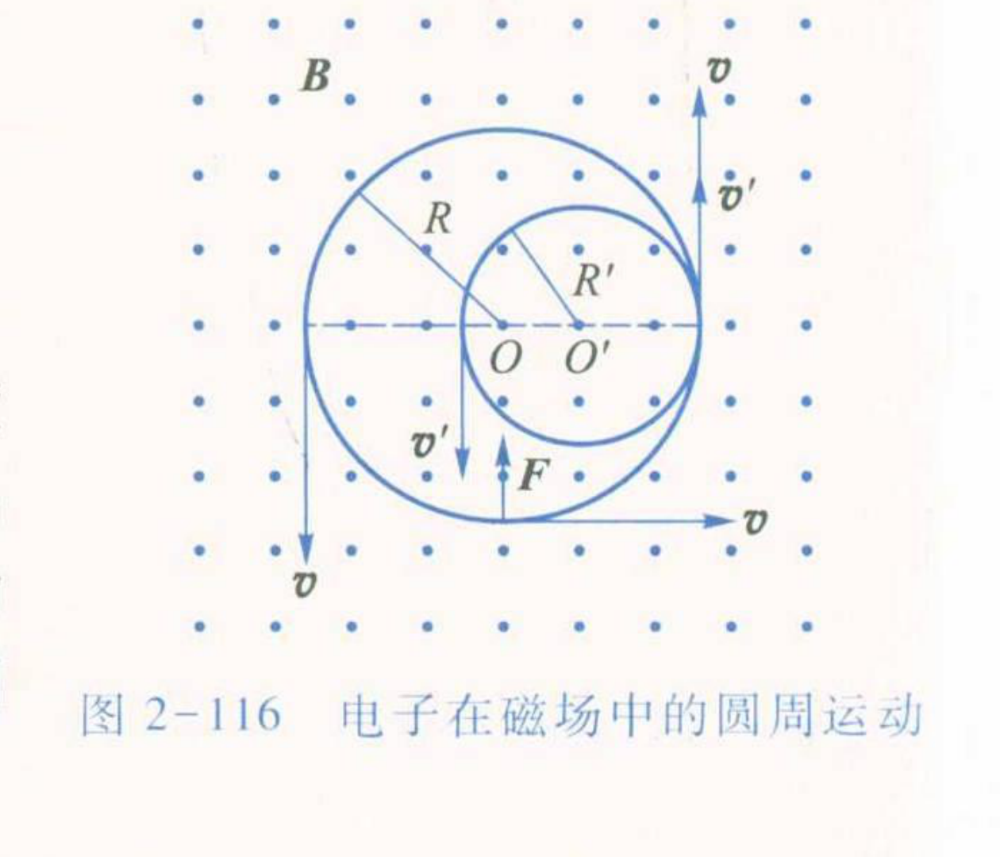
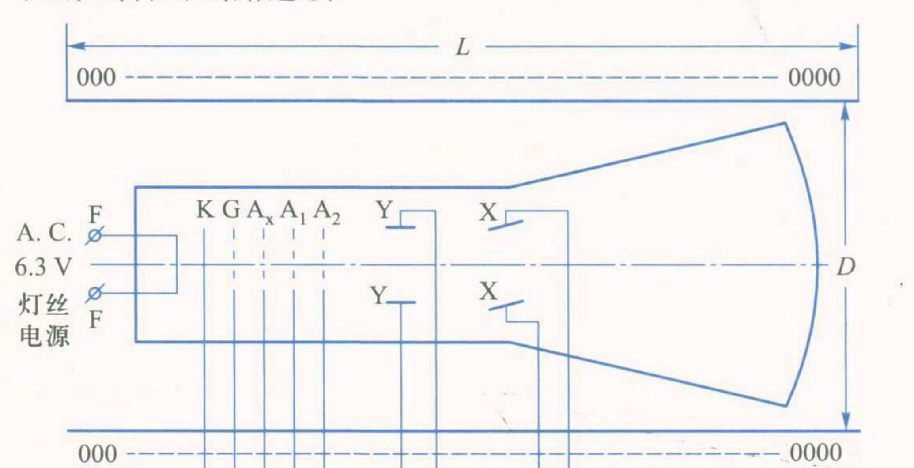
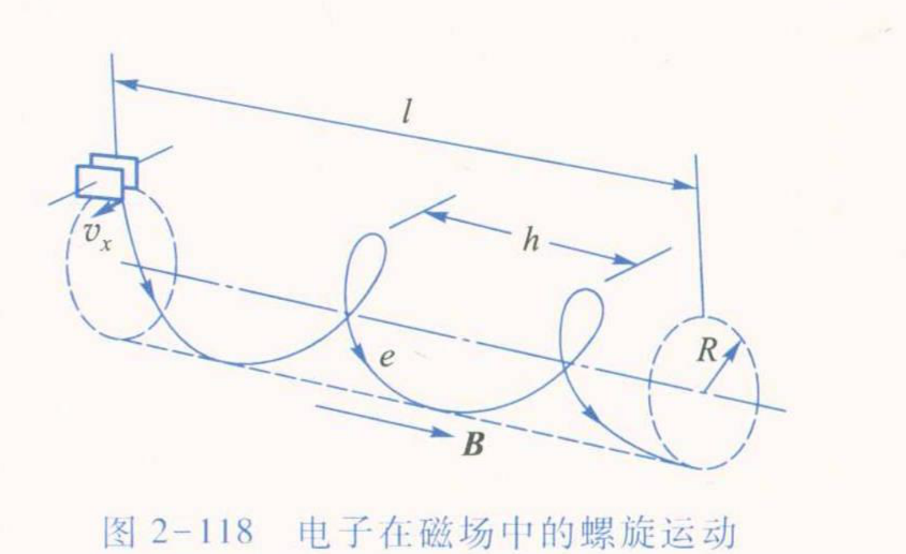

# 大学物理实验预习报告 · 用磁聚焦法测定电子荷质比（实验 2.18）

| 姓名 | 学号 | 班级 | 课程 |
|---|---|---|---|
| 孙承泽 | 2253710052 | 能动强基2501 | 大学物理实验 I-2 |

> 依据：《大学物理实验（第三版）》（高博 主编）实验 2.18，印刷页 181–186。

## 一、实验原理简述

电子经加速电压 U 获得轴向速度；横向偏转使其在轴向磁场中作螺旋运动。洛伦兹力只改变横向速度方向，回旋周期 T = 2πm/(eB)（2.18.5）；轴向每前进一个周期的距离为螺距 h = v∥T（2.18.6）。由 ½mv∥² = eU（2.18.7）得 e/m = 8π²U/(h²B²)（2.18.8）。长直螺线管轴线上 B = μ₀NI/√(L² + D²)，故 e/m = [8π²(L² + D²)/(μ₀Nh)²]·U/I²（2.18.9）。其中 U 为加速电压，I 为聚焦电流，N、L、D 分别为螺线管总匝数、长度和直径，h 为螺距。测不同 U 下的聚焦电流 I，反向励磁后重复并求平均，再据式计算 e/m。

## 二、预习思考题与解答

**1. 调节螺线管中的电流强度 I 的目的是什么？（课本“思考与讨论”1）**

① 电流 I 决定螺线管轴向磁场强度，B = μ₀NI/√(L² + D²)（式 2.18.9）；因此调 I 就是在调电子的磁场回旋周期 T = 2πm/(eB)（式 2.18.5）。

② 电子束有横向速度分量时会在磁场中作螺旋运动。改变 I 会改变每圈前进距离 h；当电子经过整数个回旋周期后重新会聚到荧光屏上，屏上可见亮点，即实现磁聚焦。

③ 因而调 I 的直接目的，是找到并维持清晰聚焦；记录聚焦时的 I，才能代入式（2.18.9）求 e/m。图 2-116 示意磁场使电子作圆周运动，螺旋运动是其与轴向匀速运动的合成。

**2. 实验时螺线管中的电流方向为什么要反向？聚焦时电流值有何不同？为什么？（课本“思考与讨论”2）**

① 螺线管轴向磁场会与地磁场沿管轴的分量叠加。反向励磁，使线圈磁场分别与该地磁分量同向、反向，比较两种方向下的聚焦电流，可减小地磁场对结果的影响。

② 同向时两磁场相加，要达到同一聚焦所需的总磁场，线圈电流较小；反向时两磁场相减，线圈须提供更大的磁场，故聚焦电流较大。若用 I₊、I₋ 表示两方向下聚焦电流的大小，取 (I₊ + I₋)/2 可抵消一阶的轴向地磁场影响，再用于计算。这里比较的是电流大小，反向操作前须先将励磁电流调至零或最小（课本 p186 注意事项）。

**3. 静电聚焦（B = 0）后，加偏转电压时，荧光屏上呈现的是一条直线而不是一个亮点，为什么？（课本“思考与讨论”3）**

① B = 0 时，电子通过 Y 偏转板后不受磁场约束；偏转板上的交变电压使电子获得大小和方向随时间变化的横向速度分量。

② 因此电子束在屏上的光点随电压变化沿一个方向往返移动。荧光屏持续发光，观察到的是光点扫过的轨迹——一条亮直线，而非固定亮点。图 2-119 中 Y 偏转板位于示波管内，荧光屏在其后方。

**4. 加上磁场后磁聚焦时，如何判定偏转板到荧光屏间是一个螺距，而不是两个、三个或更多？（课本“思考与讨论”4）**

① 同一时刻出发的电子虽因横向速度不同而走不同的螺旋线，但在同一轴向磁场中回旋周期相同；经过 T、2T、3T……后分别回到轴线附近，轴向距离依次为 h、2h、3h……（课本图 2-118）。

② 实验时从螺线管电流较小处逐渐增大，观察屏上的线状光迹逐渐缩短并首次收成细亮点。按课本操作步骤（p185），这“第一次聚焦”对应螺距 h，且 h 等于 Y 偏转板中点到荧光屏的距离；若错把第二、第三次聚焦当作一次，则该距离分别会是 2h、3h。故以从线迹开始出现的第一个清晰聚焦点作为判据，不取后续重复聚焦点。

