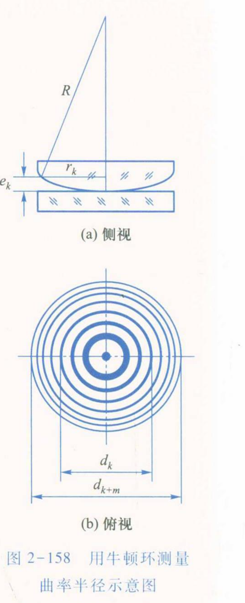
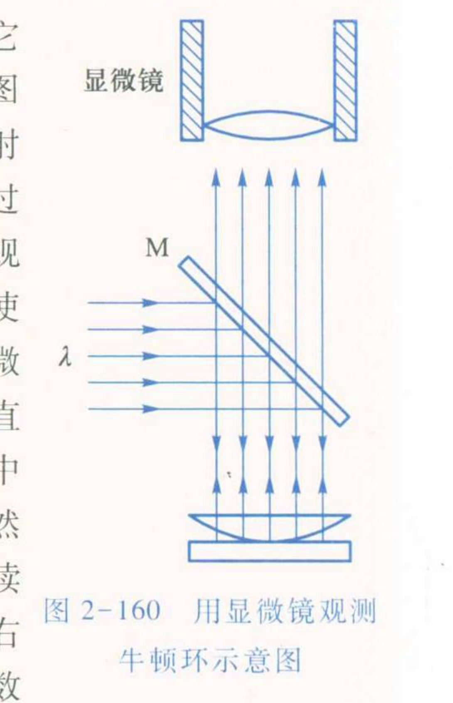

# 大学物理实验预习报告 · 等厚干涉及其应用（实验 2.22 / B309）

| 姓名 | 学号 | 班级 | 课程 |
|---|---|---|---|
| 孙承泽 | 2253710052 | 能动强基2501 | 大学物理实验 I-2 |

> 依据：《大学物理实验（第三版）》（高博 主编）实验 2.22，印刷页 219–224。

## 一、实验原理简述

薄膜上下表面反射光相干叠加；空气膜反射有半波损失，光程差 δ=2e+λ/2，同一条纹对应相同膜厚。牛顿环中 e≈r²/(2R)，暗环满足 rₖ²=kRλ；用两环直径平方差求透镜曲率半径 R。劈尖暗纹满足 eₖ=kλ/2；测暗纹级数或条纹间距可求薄片厚度 D。

## 二、预习思考题与解答

**1. 若把牛顿环暗纹直径 dₖ 对级数 k 作图，应该选 dₖ 还是 dₖ² 作纵坐标？图线斜率能给出什么物理量？**

依据：课本几何关系给出 rₖ²≈2Reₖ，反射暗纹满足 eₖ=kλ/2；测量量为暗环直径 dₖ=2rₖ。

公式与推导：合并两式，rₖ²=kRλ，因此 dₖ²=4kRλ。故 dₖ 随 k 按平方根变化，不与 k 成正比；而 dₖ² 与 k 成正比。若以 dₖ² 为纵坐标、k 为横坐标，理想直线斜率 a=4Rλ，已知 λ 后 R=a/(4λ)。

结论：应以 dₖ² 作纵坐标；线性关系可检验测得的环序与直径是否符合牛顿环模型，斜率可用于求 R。实际处理时也可按课本逐差公式用两环的平方差求 R。

**2. 测牛顿环直径时，为什么要始终朝一个方向转动鼓轮，并用相隔 5 级的暗环作平方差、对多组结果取平均？这些处理分别减小什么影响？**

依据：课本步骤要求载物台移动时鼓轮保持单向转动，并依次记录暗环两侧的位置；数据表采用相隔 5 级环的直径平方差并求平均。

公式与推导：设暗环左右边缘读数为 xₗ、xᵣ，则 dₖ=|xᵣ−xₗ|，两侧相减可消去共同的读数零点偏移。若中途反向转动，丝杠螺距差会产生回程空隙，使鼓轮刻度变化不能准确代表同向载物台位移。再由 R=(dₖ₊ₘ²−dₖ²)/(4mλ) 及 dₖ²=4kRλ，平方差为 4mRλ；在两端读数误差相近时，取较大 m 可减小该误差相对平方差的影响。不同环对分别求 R 后取平均，可减弱单次读数波动；结果明显不一致时应复查读数或环级对应。

结论：单向转动用于避免回程误差，两侧位置差消去共同零点偏移；跨越多个环级并对多组结果平均，可降低偶然读数误差的相对影响，但必须准确对应环级。

**3. 用劈尖测薄片厚度时，课本给出按总暗纹级数 N 计算和按条纹间距 s、劈尖长度 L 计算两种方法。各自依赖哪些读数，为什么记录多组间距有用？**

依据：空气劈尖相邻暗纹的膜厚差为 λ/2；课本式（2.22.5）、（2.22.6）分别用总级数和条纹间距求厚度。

公式与推导：若薄片恰对应 N 级暗纹，D=Nλ/2；若劈尖夹角 α 很小，相邻暗纹距 s 满足 α≈(λ/2)/s，而 α≈D/L，因此 D=(L/s)·λ/2。前式依赖总暗纹级数 N，后式依赖 L 和 s。为减少单次条纹定位误差对 s 的影响，课本要求隔若干条纹读位置，用跨越多条条纹的距离除以条纹数求平均间距；劈尖长度 L 也重复测量。

结论：两种方法分别利用“总级数”和“平均条纹间距及劈尖长度”确定厚度；按多条纹跨度求 s 可降低单次定位误差的相对影响，并可与总级数法互相核对。
