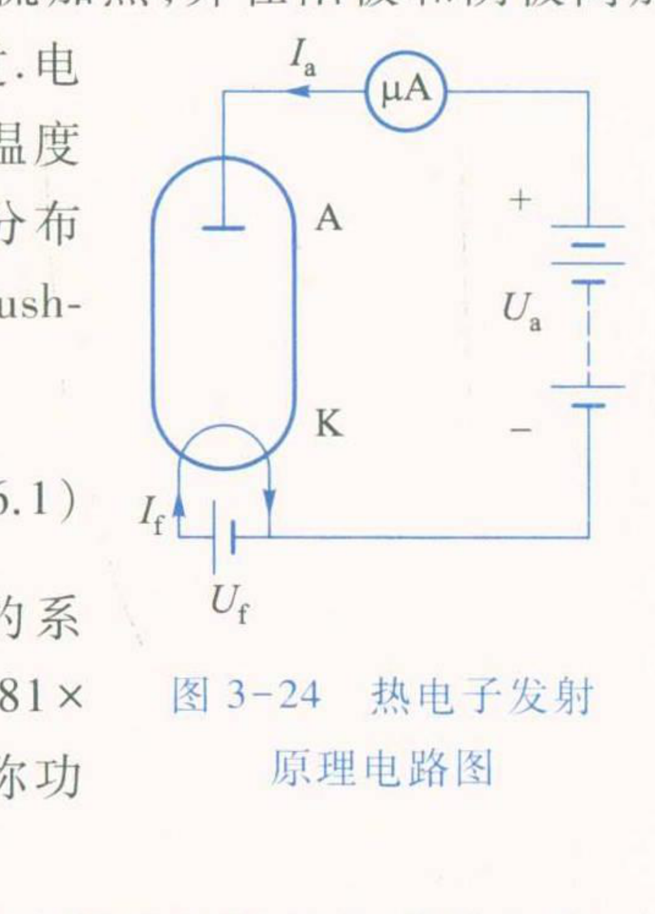
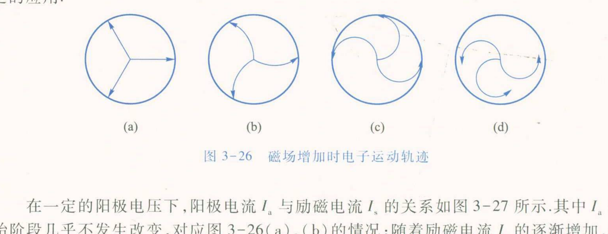
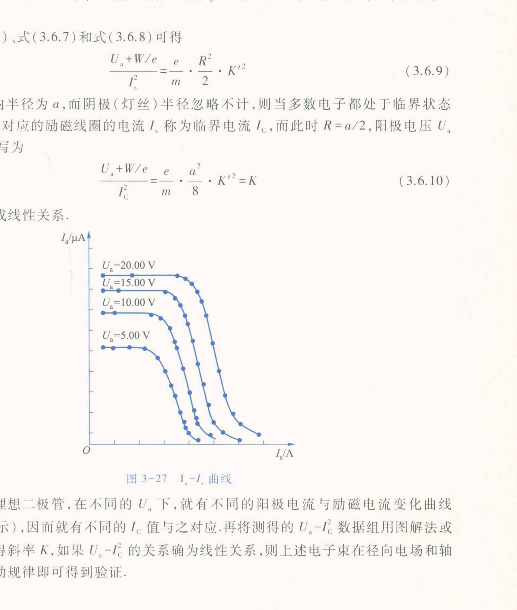

# 大学物理实验预习报告 · 金属电子逸出功与荷质比的测定（实验 3.6）

| 姓名 | 学号 | 班级 | 课程 |
|---|---|---|---|
| 孙承泽 | 2253710052 | 能动强基2501 | 大学物理实验 I-2 |

> 依据：《大学物理实验（第三版）》（高博 主编）实验 3.6，印刷页 275–282。

## 一、实验原理简述

本实验以钨丝加热的理想二极管为对象，用理查森直线法测逸出功，用磁控法测电子荷质比。热电子发射满足理查森-杜什曼公式

I = A S T² exp(-eφ/kT)　(3.6.1)

T为阴极热力学温度、k=1.381×10⁻²³ J/K、eφ为逸出功，A、S为材料系数与有效面积。取对数得

lg(I/T²) = lg A S - eφ/(2.303k)·1/T　(3.6.2)

lg(I/T²)与1/T线性，斜率求eφ。实测电流受加速电场影响产生肖特基效应：I_a = I exp(√(e³E_a)/kT)　(3.6.3)，同轴圆柱近似下E_a = U_a/(r1 ln(r2/r1))　(3.6.4)，故

lg I_a = lg I + √e³/(2.303kT√(r1 ln(r2/r1)))·√U_a　(3.6.5)

作lg I_a-√U_a直线外推到√U_a=0的截距即得零场电流I。磁控法中电子动能½mv² = eU_a+W　(3.6.6)，轴向磁场中m v²/R = evB　(3.6.7)，励磁线圈中心场B = K' I_s　(3.6.8)，其中K' = μ₀N/(2(r2-r1))·ln((r2+√(r2²+L²))/(r1+√(r1²+L²)))，推得(U_a+W/e)/I_s² = e/m·R²/2·K'²　(3.6.9)，临界时R=a/2（阳极内半径a=4.0 mm），(U_a+W/e)/I_C² = e/m·a²/8·K'² = K　(3.6.10)，U_a与I_C²线性，斜率K求e/m。本仪器励磁线圈r1=24.0 mm、r2=36.0 mm、半长L=18.0 mm、匝数N=800，得K'=1.445×10⁻²，B =1.445×10⁻² I_C。

## 二、预习思考题与解答

**1. 为什么不能直接把加速电压下的I_a代入(3.6.1)求逸出功？lg I_a-√U_a直线与lg(I/T²)-1/T直线各起什么作用？若跳过第一步会带来什么偏差？**

① 直接代入的偏差：(3.6.1)中的I是零场热发射电流，而实测I_a是在阳极加速电压U_a下的电流。阳极电场使阴极表面势垒降低，更多电子逸出，即肖特基效应，I_a = I exp(√(e³E_a)/kT)　(3.6.3)，且E_a = U_a/(r1 ln(r2/r1))　(3.6.4)。若用I_a代替I，相当于把场致增强的电流当成纯热发射，算得的I偏大，按(3.6.2)外推会使截距与斜率均偏。② 第一步直线的作用：对同一灯丝温度T，测不同U_a下的I_a，按(3.6.5)作lg I_a-√U_a图，斜率含T与几何因子，截距√U_a=0处即lg I，即消除了E_a影响的零场电流。图3-24为该测量的电路：阴极K经灯丝电流I_f加热，阳极A加U_a，微安表测I_a。③ 第二步直线的作用：对不同T得到的零场I，作lg(I/T²)-1/T图，按(3.6.2)斜率=-eφ/(2.303k)，直接求eφ，且截距lg A S只影响平移、不影响斜率，巧妙避开A、S难以直接测定的困难。若跳过第一步，用某一固定U_a下的I_a作第二步图，不同T下的场增强因子√U_a/T不同，数据点不再满足(3.6.2)的线性关系，拟合斜率将系统偏小，逸出功被低估。

**2. 灯丝温度T如何确定？表格与“等待稳定”“同一坐标作7条直线”的要求各针对什么？**

① T的确定：灯丝温度高达约2000 K，课本用光学高温计直接测量，或在不测温时按表3-6-1“灯丝电流–温度”关系由灯丝加热电流I_f查得；该实验I_f取0.600→0.800 A，对应T=1.88→2.20×10³ K，步进0.025 A。② 等待稳定的意义：每改变一次I_f，需略等2分钟待阴极温度与发射达到热平衡，若立即读数，T仍在漂移，同一U_a下的I_a会随时间上升，lg I_a-√U_a点分散、截距不准，进而使该温度点的零场I偏高；连续多个温度点的偏差会使lg(I/T²)-1/T的点呈弧形而非直线。③ 同一坐标作7条直线：表3-6-2要求对每个I_f（7个温度）都在同一U_a范围（16.0、25.0、36.0、49.0、64.0、81.0、100.0 V，对应√U_a=4.0–10.0）测I_a，并在表3-6-3中把7个T的lg I_a-√U_a数据并置，用相同横纵尺度作图，可直观比较不同T的斜率随T增大而减小（式(3.6.5)分母含T）以及截距的单调变化，便于发现某条直线因温度未稳而偏离族线的异常。

**3. 磁控法中图3-26的(a)–(d)与图3-27的I_a-I_s曲线如何对应？为什么曲线是渐变而课本取I_a最大值的1/4处Q为临界点？如何由U_a-I_C²求e/m？**

① 轨迹对应：图3-26为理想二极管中阴极电子在轴向磁场B下的运动俯视；(a) B=0时电子沿径向直飞阳极，对应图3-27各U_a曲线左端平坦段，I_a近似最大值I_a0；(b) B较小时轨迹弯曲但仍到达阳极，I_a微降；(c) B达临界值，轨迹恰擦阳极内壁(R=a/2)，大量电子处于临界状态，对应曲线曲率最大处；(d) B更大时电子做半径更小的圆周运动无法到达阳极，I_a趋零，对应右端尾部。② 渐变原因：理论上单能量单位置电子应在临界场突变断流，但真实阴极发射的电子按费米-狄拉克分布有能量展宽，且理想二极管阴极与阳极不完全同轴、各处间距不等，不同电子的临界B不同，随B增大依次进入临界，故I_a是逐步下降的S形曲线，而非阶跃。③ Q的统计意义：课本取I_a-I_s曲线上I_a = I_a0·1/4高度的点Q对应I_s = I_C，作为“多数电子处于临界”的统计平均临界电流；该定义与能量分布的中位相关，不同速率电子的临界点分布在此附近，用1/4高度可减小分布拖尾对读数的影响。④ 求e/m：对不同U_a（图3-27中5.00、10.0、15.0、20.0 V等）分别取I_C，作(U_a+W/e)-I_C²图，按(3.6.10)应为过原点直线，斜率K = e/m·a²/8·K'²，a=4.0 mm，K'=1.445×10⁻²已知，W为电子热运动能量通常远小于eU_a可近似忽略或计入截距，解得e/m = 8K/(a² K'²)，与理论值1.759×10¹¹ C/kg比较算百分误差。
