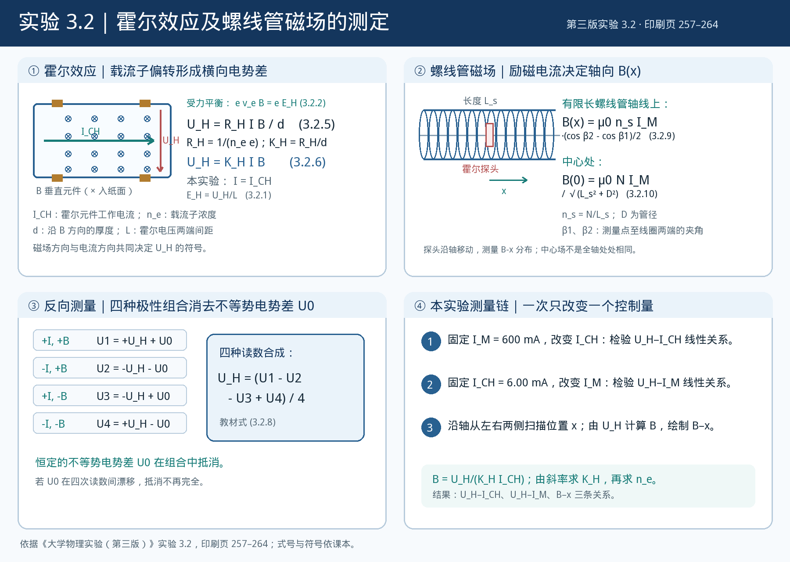

# 大学物理实验预习报告 · 霍尔效应及螺线管磁场的测定（实验 3.2）

| 姓名 | 学号 | 班级 | 课程 |
|---|---|---|---|
| 孙承泽 | 2253710052 | 能动强基2501 | 大学物理实验 I-2 |

> 依据：《大学物理实验（第三版）》（高博 主编）实验 3.2，印刷页 257–264。

## 一、实验原理简述

## 二、预习思考题与解答

**1. 四极性测量能消去恒定的不等势电势差；如果四次读数期间 U0 缓慢漂移，残差会怎样进入 U_H？改变测量顺序能否减小它？**

① 设四个工作状态下的不等势电势差分别为 U01、U02、U03、U04，则读数为 U1=U_H+U01、U2=−U_H−U02、U3=−U_H+U03、U4=U_H−U04。代入教材式（3.2.8）可得

U_H,测 = (U1−U2−U3+U4)/4 = U_H + (U01+U02−U03−U04)/4。

因此，若 U0 在四次测量中保持相同，最后一项严格抵消；若它随时间变化，剩余组合一般不为零，会被误认为霍尔电压的一部分。

② 以等时间间隔、近似线性漂移 U0(t)=a+bt 为例，按“1、2、3、4”顺序测量时，偏差为 (U01+U02−U03−U04)/4；将顺序倒转为“4、3、2、1”后，线性漂移项符号相反。若设备与操作允许，可将正序和逆序得到的 U_H,测 再取平均，以减弱一阶时间漂移。

③ 这并不能消除任意快速或非线性的漂移，所以仍应尽量缩短四种状态之间的间隔，并记录每次读数的状态与顺序。若正序、逆序结果差异明显，应先检查零点和稳定性，不宜只把两组数平均后就认定系统误差已完全消除。

**2. 为什么验证 U_H−I_CH 与 U_H−I_M 关系时要分别固定一个电流？若两种电流同时改变，曲线可能被怎样误读？**

① 对固定位置的霍尔元件，教材给出 U_H=K_H I_CH B。螺线管几何尺寸和位置不变时，轴向磁场 B 与励磁电流 I_M 成正比，可写作 B=c(x)I_M，其中 c(x) 由位置和线圈几何决定。因此 U_H=K_H c(x) I_CH I_M，是两个电流的乘积关系。

② 验证 U_H 与 I_CH 的关系时，应固定 I_M 和位置，使 B 不变；这样 U_H 对 I_CH 才是斜率为 K_H B 的直线。验证 U_H 与 I_M 的关系时，则固定 I_CH 和位置，使 U_H 对 I_M 呈线性。

③ 若同时把 I_CH 和 I_M 按同一比例增加，U_H 会随两者乘积改变；例如二者都加倍，理想情况下 U_H 变为原来的四倍。此时若只把变化归因于其中一个电流，就会错误判断其线性斜率。教材的操作分别固定 I_M=600 mA、固定 I_CH=6.00 mA，正是为了将两个因素的作用分开检验。

**3. 有限长螺线管的轴向 B−x 曲线应具有什么几何特征？怎样利用左右两侧重复扫描判断曲线差异来自真实场分布还是测量偏差？**

① 对几何对称、励磁稳定的螺线管，若以线圈中心为 x=0，轴线上磁场大小关于中心对称，即 B(x)=B(−x)；中心处磁场较强，靠近两端则减弱。教材式（3.2.9）给出有限长线圈轴向磁场，式（3.2.10）给出中心场。由 U_H=K_H I_CH B，在 I_CH 和 K_H 已知且保持不变时，可由各位置的 U_H 换算 B(x)。

② 因而左右两侧等距位置的 B 值（或经极性修正后的 U_H）应近似相等。若只扫描一侧，很难分辨曲线的不对称究竟是线圈端部的真实变化，还是位置零点、探头姿态、励磁波动或反向测量残差造成的偏差。两侧扫描提供了几何对照。

③ 处理时先按线圈中心统一左右坐标，再比较镜像位置；若两侧整体偏移或不重合，应复核中心定位、位置读数和电流稳定性，并重复扫描。只有差异在复测中仍稳定存在，才有依据讨论线圈或装置的实际不对称；不应把单侧的一组波动直接解释成磁场结构。
