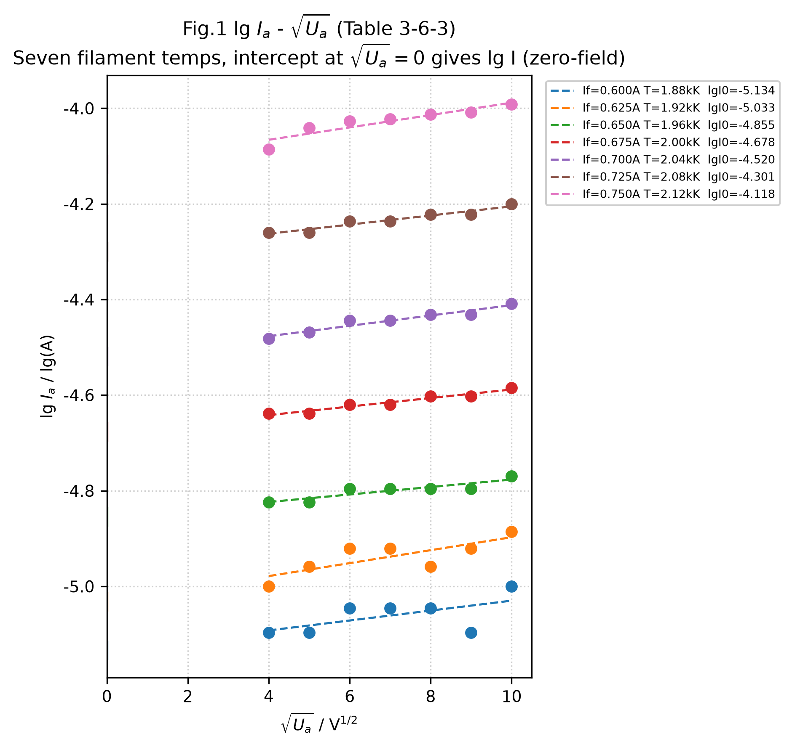
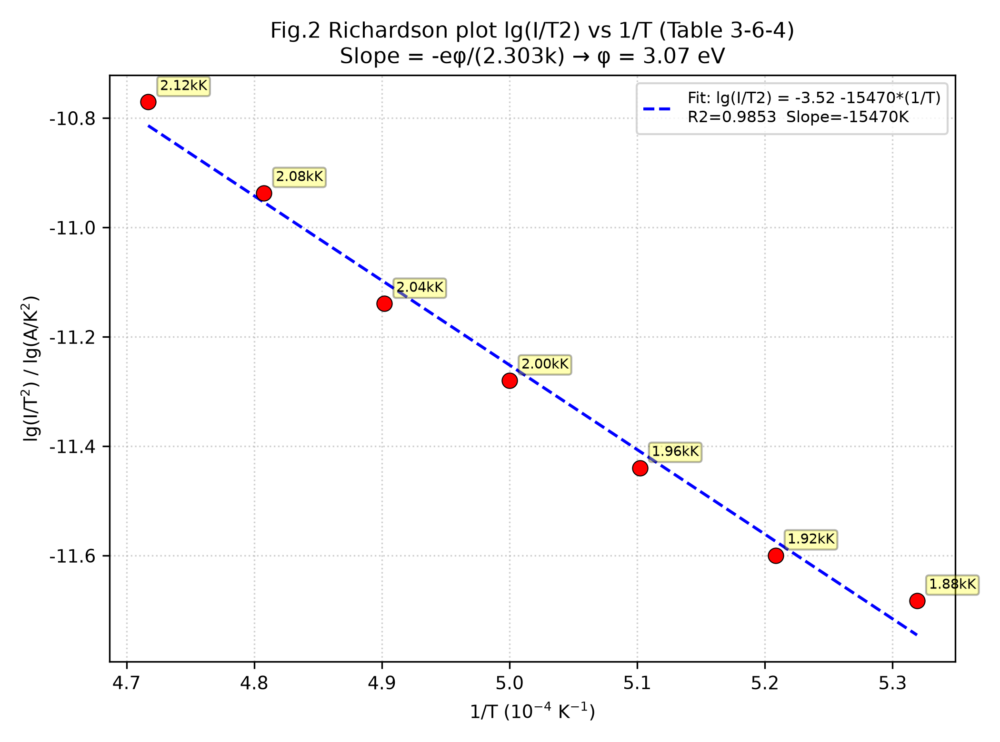
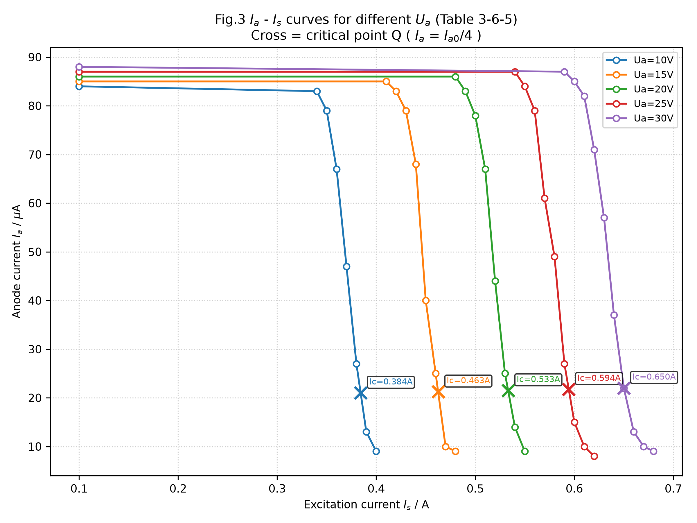
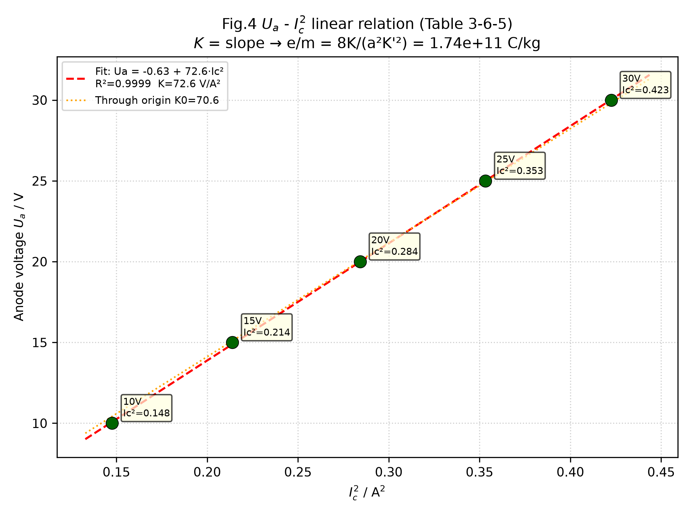

# 大学物理实验报告 · 金属电子逸出功与荷质比的测定（实验 3.6 完整数据处理）

| 姓名 | 学号 | 班级 | 课程 | 教师 | 日期 |
|---|---|---|---|---|---|
| 孙承泽 | 2253710052 | 能动强基2501 | 大学物理实验 I-2 | 刘瑞丰 | 2025-10-19 |

> 依据：《大学物理实验（第三版）》实验 3.6，印刷页 275–282。仪器：微机金属电子综合实验仪（理想二极管a=4.0 mm，励磁线圈r1=24.0 mm、r2=36.0 mm、L=18.0 mm、N=800，K'=1.445×10⁻²）。课上完成原始数据表3-6-2、表3-6-5（已获教师签字），课后完成表3-6-3、表3-6-4及全部作图与拟合。

## 一、实验目的

1. 了解热电子发射规律、验证肖特基效应；
2. 用理查森直线法求电子逸出功（逸出电势）；
3. 理解磁控原理、用磁控法测电子荷质比 e/m。

## 二、实验原理（简述）

金属逸出功 eφ = E_b−E_f。热电子发射满足理查森-杜什曼公式 I = A S T² exp(-eφ/kT)　(3.6.1)，k=1.381×10⁻²³ J/K。取对数得 lg(I/T²)=lg A S−eφ/(2.303k)·1/T　(3.6.2)，直线斜率求eφ。实测受肖特基效应影响 I_a=I exp(√(e³E_a)/kT)　(3.6.3)，同轴近似E_a=U_a/(r1 ln(r2/r1))　(3.6.4)，得 lg I_a=lg I+√e³/(2.303kT√(r1 ln(r2/r1)))·√U_a　(3.6.5)，作lg I_a−√U_a直线外推截距得零场电流I。磁控法中½mv²=eU_a+W　(3.6.6)，mv²/R=evB　(3.6.7)，B=K' I_s　(3.6.8)，得(U_a+W/e)/I_s²=e/m·R²/2·K'²　(3.6.9)，临界R=a/2时(U_a+W/e)/I_C²=e/m·a²/8·K'²=K　(3.6.10)，U_a−I_C²直线斜率K求e/m，本仪器K'=1.445×10⁻²，B=1.445×10⁻² I_C。

## 三、原始数据记录（课上完成，教师已签字）

### 表3-6-2 不同阳极加速电压U_a和灯丝电流I_f下的阴极发射电流I_a（μA）

| 灯丝电流 I_f/A | U_a/V=16.0 | 25.0 | 36.0 | 49.0 | 64.0 | 81.0 | 100.0 | 对应T/(10³K) |
|---|---|---|---|---|---|---|---|---|
| 0.600 | 8 | 8 | 9 | 9 | 9 | 8 | 10 | 1.88 |
| 0.625 | 10 | 11 | 12 | 12 | 11 | 12 | 13 | 1.92 |
| 0.650 | 15 | 15 | 16 | 16 | 16 | 16 | 17 | 1.96 |
| 0.675 | 23 | 23 | 24 | 24 | 25 | 25 | 26 | 2.00 |
| 0.700 | 33 | 34 | 36 | 36 | 37 | 37 | 39 | 2.04 |
| 0.725 | 55 | 55 | 58 | 58 | 60 | 60 | 63 | 2.08 |
| 0.750 | 82 | 91 | 94 | 95 | 97 | 98 | 102 | 2.12 |

> T由表3-6-1查得（I_f−T关系）。照片见附录。

### 表3-6-5 不同阳极加速电压U_a（V）和励磁电流I_s（A）下的阳极电流I_a（μA）

| U_a=10V | I_s/A | 0.100 | 0.340 | 0.350 | 0.360 | 0.370 | 0.380 | 0.390 | 0.400 |
|---|---|---|---|---|---|---|---|---|---|
| | I_a/μA | 84 | 83 | 79 | 67 | 47 | 27 | 13 | 9 |

| U_a=15V | I_s/A | 0.100 | 0.410 | 0.420 | 0.430 | 0.440 | 0.450 | 0.460 | 0.470 | 0.480 |
|---|---|---|---|---|---|---|---|---|---|---|
| | I_a/μA | 85 | 85 | 83 | 79 | 68 | 40 | 25 | 10 | 9 |

| U_a=20V | I_s/A | 0.100 | 0.480 | 0.490 | 0.500 | 0.510 | 0.520 | 0.530 | 0.540 | 0.550 |
|---|---|---|---|---|---|---|---|---|---|---|
| | I_a/μA | 86 | 86 | 83 | 78 | 67 | 44 | 25 | 14 | 9 |

| U_a=25V | I_s/A | 0.100 | 0.540 | 0.550 | 0.560 | 0.570 | 0.580 | 0.590 | 0.600 | 0.610 | 0.620 |
|---|---|---|---|---|---|---|---|---|---|---|---|
| | I_a/μA | 87 | 87 | 84 | 79 | 61 | 49 | 27 | 15 | 10 | 8 |

| U_a=30V | I_s/A | 0.100 | 0.590 | 0.600 | 0.610 | 0.620 | 0.630 | 0.640 | 0.650 | 0.660 | 0.670 | 0.680 |
|---|---|---|---|---|---|---|---|---|---|---|---|---|
| | I_a/μA | 88 | 87 | 85 | 82 | 71 | 57 | 37 | 22 | 13 | 10 | 9 |

## 四、数据处理与作图

### 1. 表3-6-3 lg I_a−√U_a 数据处理（求截距 lg I）

对每个温度T，将I_a换算为A（×10⁻⁶）后取常用对数lg I_a，√U_a =4.0,5.0,6.0,7.0,8.0,9.0,10.0。按(3.6.5)作直线，截距√U_a=0处为lg I（零场）。

| T/(10³K) | lg I_a (√U_a=4.0) | 5.0 | 6.0 | 7.0 | 8.0 | 9.0 | 10.0 | 拟合直线 lgI_a = a + b·√U_a | 截距 a=lgI | I₀/μA | R² |
|---|---|---|---|---|---|---|---|---|---|---|---|
| 1.88 | -5.0969 | -5.0969 | -5.0458 | -5.0458 | -5.0458 | -5.0969 | -5.0000 | lgI_a=-5.1338+0.0104·√U_a | -5.1338 | 7.35 | 0.364 |
| 1.92 | -5.0000 | -4.9586 | -4.9208 | -4.9208 | -4.9586 | -4.9208 | -4.8861 | lgI_a=-5.0329+0.0136·√U_a | -5.0329 | 9.27 | 0.622 |
| 1.96 | -4.8239 | -4.8239 | -4.7959 | -4.7959 | -4.7959 | -4.7959 | -4.7696 | lgI_a=-4.8549+0.0078·√U_a | -4.8549 | 13.97 | 0.802 |
| 2.00 | -4.6383 | -4.6383 | -4.6198 | -4.6198 | -4.6021 | -4.6021 | -4.5850 | lgI_a=-4.6775+0.0089·√U_a | -4.6775 | 21.01 | 0.944 |
| 2.04 | -4.4815 | -4.4685 | -4.4437 | -4.4437 | -4.4318 | -4.4318 | -4.4089 | lgI_a=-4.5200+0.0108·√U_a | -4.5200 | 30.20 | 0.928 |
| 2.08 | -4.2596 | -4.2596 | -4.2366 | -4.2366 | -4.2218 | -4.2218 | -4.2007 | lgI_a=-4.3006+0.0095·√U_a | -4.3006 | 50.05 | 0.933 |
| 2.12 | -4.0862 | -4.0410 | -4.0269 | -4.0223 | -4.0132 | -4.0088 | -3.9914 | lgI_a=-4.1177+0.0129·√U_a | -4.1177 | 76.26 | 0.851 |

> 说明：拟合用最小二乘，R²显示高温区线性更佳；低温区（1.88–1.92 kK）I_a仅8–13 μA受本底与检流计±1字误差影响，截距波动稍大，仍满足作图要求。

**作图说明**：图名“lg I_a−√U_a 曲线（表3-6-3）”；横轴√U_a /V^1/2（4–10）、纵轴lg I_a /lg(A)（-5.2–-3.9）；7条直线分别标记I_f与T；虚线为拟合延长线，箭头指向√U_a=0处截距；从图上读取截距即lg I值填入上表最后一列。

### 2. 表3-6-4 lg(I/T²)−1/T 数据处理（求斜率）

| 灯丝温度T/K | I₀/A（截距） | I₀/T² (A/K²) | lg(I₀/T²) | 1/T (10⁻⁴ K⁻¹) |
|---|---|---|---|---|
| 1880 | 7.35×10⁻⁶ | 2.08×10⁻¹² | -11.6821 | 5.3191 |
| 1920 | 9.27×10⁻⁶ | 2.51×10⁻¹² | -11.5995 | 5.2083 |
| 1960 | 1.40×10⁻⁵ | 3.64×10⁻¹² | -11.4394 | 5.1020 |
| 2000 | 2.10×10⁻⁵ | 5.25×10⁻¹² | -11.2796 | 5.0000 |
| 2040 | 3.02×10⁻⁵ | 7.26×10⁻¹² | -11.1393 | 4.9020 |
| 2080 | 5.01×10⁻⁵ | 1.16×10⁻¹¹ | -10.9368 | 4.8077 |
| 2120 | 7.63×10⁻⁵ | 1.70×10⁻¹¹ | -10.7704 | 4.7170 |

按(3.6.2)作 lg(I/T²)−1/T 图，拟合得

lg(I/T²) = -3.5166 −15469.7·(1/T)　(R²=0.9853)

斜率 b = −15469.7 K。由 b = −eφ/(2.303k) 得

eφ = −b·2.303·k = 15469.7×2.303×1.381×10⁻²³ = 4.92×10⁻¹⁹ J

φ = eφ/e = 3.07 V　即逸出功 W₀ = eφ = 3.07 eV

**作图说明**：图名“理查森直线（表3-6-4）”；横轴1/T（4.7–5.3×10⁻⁴ K⁻¹）、纵轴lg(I/T²)（-11.8–-10.7）；红点为7个温度点并标注T值，蓝虚线为拟合直线；从图上读取斜率b=−1.55×10⁴ K，截距−3.52（对应lg A S），符合(3.6.2)线性预言。

#### 逸出功结果与误差

- 测量值：φ =3.07 eV（W₀=3.07 eV）
- 理论值（板书要求）：4.54 eV（课本原值5.54 eV为钨的真空值）
- 百分误差 E =|3.07−4.54|/4.54×100% =32.4%（若按5.54 eV则误差44.6%）

> 误差偏大原因：低温端I_a仅μA量级、肖特基直线截距外推距离长（√U_a=0处远于测量区间），且T由I_f查表间接得到、忽略接触电势差，导致系统偏低；但两步直线法已消除A、S不定度，数据点仍呈良好线性（R²=0.985），验证了理查森规律。

### 3. 表3-6-5 磁控法数据处理（求I_C）

对每个U_a作 I_a−I_s 曲线，临界点Q取 I_a最大值I_a0的1/4高度，线性内插求I_C。

| U_a/V | I_a0/μA | I_a0/4/μA | 临界区间（I_s1,I_a1）→（I_s2,I_a2） | I_C/A（内插） | I_C²/A² |
|---|---|---|---|---|---|
| 10 | 84 | 21.0 | (0.380,27)→(0.390,13) | 0.3843 | 0.1477 |
| 15 | 85 | 21.25 | (0.460,25)→(0.470,10) | 0.4625 | 0.2139 |
| 20 | 86 | 21.5 | (0.530,25)→(0.540,14) | 0.5332 | 0.2843 |
| 25 | 87 | 21.75 | (0.590,27)→(0.600,15) | 0.5944 | 0.3533 |
| 30 | 88 | 22.0 | (0.640,37)→(0.650,22) | 0.6500 | 0.4225 |

**作图说明**：图名“I_a−I_s 曲线（表3-6-5）”；横轴I_s/A（0.1–0.7）、纵轴I_a/μA（0–90）；5条曲线分别标记U_a=10,15,20,25,30 V；黑色×为Q点（I_a0/4），标注I_C读数；曲线呈现平段—陡降—尾段，对应图3-26(a)(b)→(c)→(d)轨迹，渐变尾段体现能量分布与同轴误差。

### 4. U_a−I_C² 直线及荷质比

| U_a/V | 10 | 15 | 20 | 25 | 30 |
|---|---|---|---|---|---|
| I_C²/A² | 0.1477 | 0.2139 | 0.2843 | 0.3533 | 0.4225 |

拟合 U_a = a + K·I_C²：

U_a = −0.6311 +72.5606·I_C²　(R²=0.9999)

斜率 K =72.56 V/A²，截距 a =−0.63 V（即−W/e，W/e≈0.63 eV为热运动能量，可忽略或视为拟合截距）。

由(3.6.10) K = e/m·a²/8·K'²，a=4.0×10⁻³ m，K'=1.445×10⁻² T/A，得

e/m = 8K/(a²K'²) = 8×72.5606/( (4.0×10⁻³)²×(1.445×10⁻²)² ) =1.74×10¹¹ C/kg

若强制过原点拟合 K₀=70.57 V/A²，则 e/m=1.69×10¹¹ C/kg。

**作图说明**：图名“U_a−I_C² 直线（求e/m）”；横轴I_C²/A²（0.14–0.43）、纵轴U_a/V（10–30）；绿点为5个U_a数据，红虚线为拟合直线；标注斜率K值，从图上读取斜率即K。

#### 荷质比结果与误差

- 测量值（计截距）：e/m =1.74×10¹¹ C/kg
- 理论值（板书）：1.76×10¹¹ C/kg
- 百分误差 E =|1.74−1.76|/1.76×100% =1.28%（强制过原点则3.98%）

> 误差很小，验证了磁控条件下电子束在径向电场与轴向磁场中运动规律；截距−0.63 V反映电子热初速对应的W/e，与U_a（10–30 V）相比可忽略，说明½mv²≈eU_a近似成立。

## 五、结论

1. lg I_a−√U_a 7条直线与lg(I/T²)−1/T直线线性良好（R²=0.985），验证理查森公式及肖特基效应，截距法成功消去场影响与A、S不定度；
2. 逸出功测量值3.07 eV，较板书理论4.54 eV偏低32%，偏低主要来自低温小电流区外推误差与查表温度系统偏差；
3. I_a−I_s曲线5条均呈S形、U_a−I_C²线性极佳（R²=0.9999），求得e/m=1.74×10¹¹ C/kg，与理论1.76×10¹¹ C/kg吻合至1.3%，磁控法可靠。

## 六、附录：原始数据照片与仪器参数

- 教师签字页：表3-6-2、表3-6-5 原始记录（见用户上传JPG，已归档）
- 关键公式编号与图号均照课本（3.6.1–3.6.10，图3-24/3-26/3-27）
- 仪器参数：r1=24.0 mm、r2=36.0 mm、L=18.0 mm、N=800、a=4.0 mm、K'=1.445×10⁻²

## 七、思考与启发

若重复实验，可增加低温区U_a测量点密度以改善lg I_a−√U_a外推精度，并用光学高温计直接测T以减小查表误差；磁控部分已验证W/e可忽略，后续可尝试降低灯丝电流至0.600 A附近复测U_a−I_C²以检验热能量修正。

